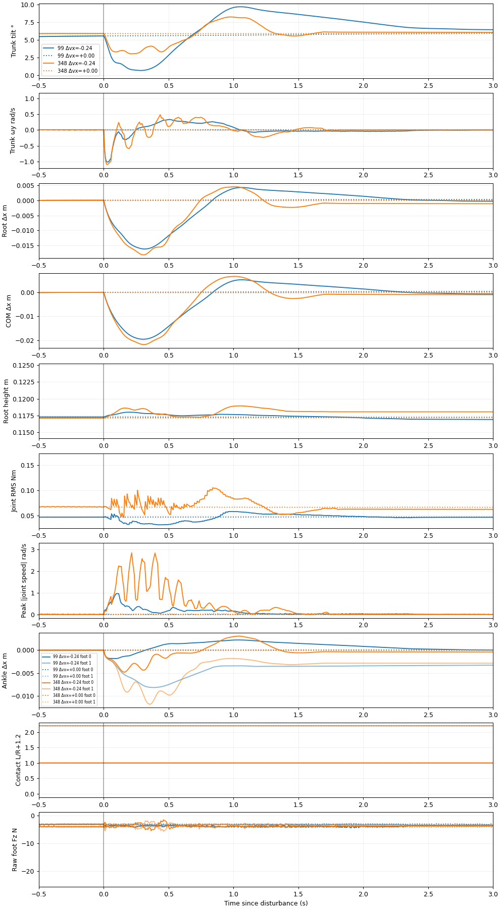
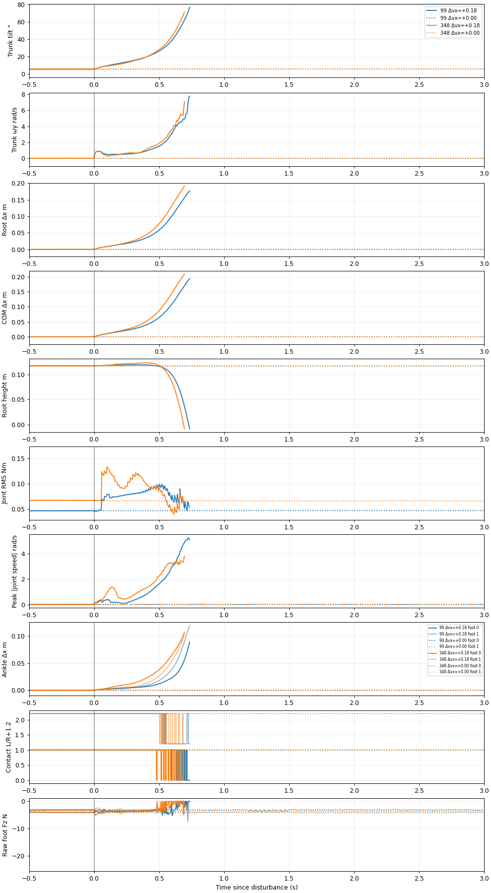

## Scientific summary

Both controllers show contact-maintaining recovery at the smaller tested disturbances and falling-like loss of posture at larger forward disturbances. At this sampling resolution, the policies have the **same categorical forward outcomes**: both seeds recover at +0.12 m/s and terminate at +0.18 and +0.24 m/s. This establishes an observed transition span, not a continuous recoverability threshold.

Backward outcomes depend strongly on seed: both policies and seeds recover at −0.18 m/s; at −0.24 m/s both seed-42 trials recover and both seed-43 trials terminate. Thus the tested backward responses tolerate a larger velocity increment than the forward responses, but there is no single seed-independent cutoff. The two seeds change inherited observation-delay behavior under identical nominal initial generalized states; they are not independent randomized physical initial conditions.

No smaller-failure/larger-survival reversal was observed on this sampled grid within a matched policy/seed/direction. The experiment deliberately retains every point and includes independent ±0.03 m/s interior audits, but this sparse sampling cannot rule out unsampled recovery islands, timing sensitivity, or nonmonotonic responses elsewhere. Neither the shared categorical outcomes nor the continuous trajectory differences establish that checkpoint 348 is generally better or worse.

## Representative behavior

- **Backward −0.18 m/s:** all four trajectories recover without conservative step evidence. Recovery takes 0.065–0.075 s for 99 and 0.125–0.380 s for 348. These are threshold-window onset times, not settling time constants.
- **Backward −0.24 m/s, seed 42:** both retain sampled foot contacts. Checkpoint 348 recovers in 0.760 s; 99 in 1.540 s. Final mean root displacement is about 3.5 and 3.8 mm, respectively. The largest joint effort peaks are about 0.313 Nm for 348 (right ankle) and 0.134 Nm for 99 (right knee). This condition reverses the recovery-time ordering at −0.18; effort does not measure stiffness or prove why recovery occurred.
- **Return versus recovery:** 99's surviving −0.24 trial retains about 3.43° mean trunk-orientation change, including yaw, whereas 348 retains about 2.12°. The former misses the new 3° return tolerance despite passing the unchanged 00B recovery rule. This is a threshold-dependent distinction between nearby final postures, not proof of a different attractor or a superior controller.
- **Backward −0.24 m/s, seed 43:** 348 crosses 12° tilt at 0.485 s, first loses foot contact at 0.600 s, loses 4 cm of root height at 0.670 s, and terminates at 0.775 s after injection. For 99 those times are 0.665, 0.775, 0.845, and 0.935 s. Peak angular speeds are about 13.4 and 7.8 rad/s. These are different collapse trajectories, not a causal diagnosis of an actuator or contact failure.
- **Forward +0.18 m/s:** all four trials show tilt growth, contact loss, height loss and termination. Trunk tilt crosses 12° at 0.190–0.375 s; first foot contact loss occurs at 0.485–0.640 s; termination follows at 0.695–0.855 s. The order of termination between checkpoints changes with seed. The step-evidence detector flags foot lift and displaced recontact in these failed trials. These flags describe fall-associated foot motion, not demonstrated successful stepping recovery.

The report overlays each disturbed trajectory with its own undisturbed control. `divergence.json` also compares policy responses after subtracting each policy's control, using only their common recorded time horizon. This separates baseline posture differences from disturbance responses. Joint target/actual and effort plots include both seeds for amplitudes near the observed transition. Final root/COM/posture metrics are means over the last 0.5 s, even for failed trials; they are not impact endpoints or stable final states when recovery failed.

## Validation incident and practical limits

One completed +0.06 m/s record failed exact pre-event matching and was archived under `../excluded/`; its identical-setting repeat passed. One in-progress trial was interrupted during that investigation and preserved. No acceptance tolerance was relaxed, and no record was excluded for falling. The cause of the small pre-event discrepancy remains unresolved. Strict validation now runs after every new trial. See `../excluded/README.md` for component errors and provenance. The reported completed-subprocess cost includes the excluded completed attempt and repeat; the interrupted attempt was not timed, so that sum understates total wall cost.

Early termination exposed and prompted a regression-tested validator fix: integer indices now compare a short disturbed record with the corresponding pre-event samples of a longer control. All historical 00A/00B result files are preserved. The new return criterion was refined during 00C to distinguish displacement, joint posture, and full trunk orientation; it is exploratory, not preregistered or a revision of historical recovery claims.

The experiment establishes finite-horizon simulated responses to these signed root-velocity interventions under the recorded conditions. It does not establish hardware push tolerance, an impact-force limit, a continuous safe region, population failure probabilities, actuator saturation, a support polygon, or a causal failure mechanism. Finer probes in the transition spans, more seeds and disturbance timings, and ordinary-stepping sensitivity checks near failure would be the most useful next experiments; none were launched automatically.
