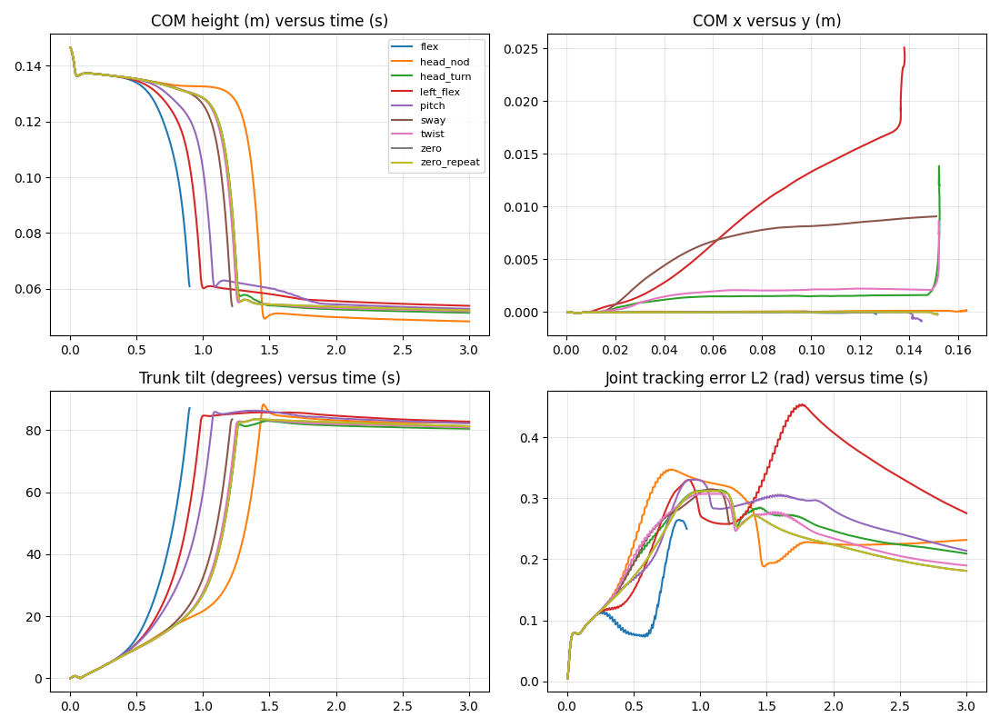

# Movement Lab 01A — Free Movement Discovery

## Findings

**Status: completed negative-result study.**

This pilot observed head articulation, bilateral and unilateral leg articulation, and differing forward-fall trajectories. It demonstrated **no controlled jump, roll, recovery, or stable endpoint**. Seven records completed as uncontrolled falls; two were stopped and marked invalid after exceeding the preset penetration threshold. All nine records are retained. Zero action also falls, so much of the body displacement is baseline gravitational collapse, not a discovered skill.

The archive contains four valid descriptive bins plus one invalid bucket. These bins distinguish measured trajectory descriptors, not four skills or statistically established behavior classes. Head turn and unilateral leg flex provide useful representatives of lateral displacement during a fall. The repeat baseline occupies the same bin and has identical generalized positions.



## Experiment and cost

No checkpoint or policy was loaded. The runner builds the installed flat velocity environment with the upstream curated **groundcontact** robot substituted locally. It keeps BAM XL330 M6 position-target actuation, friction, 7.35 V supply, 0.1 V/Nm load sag, 6 V voltage floor, ±0.96 Nm modeled torque ceiling, and a fixed four-physics-step (20 ms) command delay. These are modeled constraints, not real electrical/thermal validation. The velocity-task reward terms still compute but are neither read nor optimized.

Nominal initial configuration: upstream HOME joints, zero generalized velocity, zero x/y/yaw reset offsets and +0.125 m root z reset offset, seed 42. Initial whole-body COM height was approximately 0.14675 m. Every trial resets independently to the same configuration. No settling policy is used; the baseline does not stand. Initial unsupported descent is included in measurements.

Each manual sequence commands offsets from default joint targets: idle until 0.2 s, cosine rise to full amplitude at 0.8 s, hold through 1.2 s, cosine return by 1.8 s, and default-target hold until 3 s. Maximum offset is 0.25 rad; maximum continuous target slew is about 0.655 rad/s. Targets are checked with a 0.02 rad margin from hard joint limits. Commands update at 50 Hz; measurements sample at 200 Hz. No direct torque injection, joint teleportation, or action optimization is used.

The proposed budget was nine 3 s trials (27 simulated seconds; 5,400 physics steps), estimated at 5–10 minutes. The completed pilot used **101.57 s wall time**, including environment setup and nine trial executions, but excluding report generation and preflight debugging. Early safety stops reduced integrated time to **23.12 s / 4,624 physics steps**. Measured per-trial wall times are in metadata. Preflight attempts and their exclusions are documented in [ATTEMPTS.md](../ATTEMPTS.md); their wall times were not consistently measured and are additional to this cost.

## Atlas of observations

Names describe commanded joint groups, not inferred skills. Displacement and height changes are relative to t=0. ROM is the largest measured single-joint range; work is sampled absolute mechanical work, not battery energy.

| Sequence | Recorded s | Final COM Δx / Δy (mm) | Max tilt ° | Max joint ROM rad | Work J | Outcome |
|---|---:|---:|---:|---:|---:|---|
| flex | 0.90 | 126.0 / -0.2 | 87.2 | 0.394 | 0.107 | invalid penetration; stopped |
| head_nod | 3.00 | 162.9 / 0.2 | 88.4 | 0.216 | 0.115 | uncontrolled fall |
| head_turn | 3.00 | 152.0 / 12.1 | 83.0 | 0.225 | 0.134 | uncontrolled fall |
| left_flex | 3.00 | 137.5 / 25.1 | 85.8 | 0.373 | 0.168 | uncontrolled fall |
| pitch | 3.00 | 144.5 / -0.9 | 86.3 | 0.296 | 0.113 | uncontrolled fall |
| sway | 1.22 | 150.6 / 9.1 | 83.5 | 0.205 | 0.075 | invalid penetration; stopped |
| twist | 3.00 | 152.0 / 7.5 | 83.6 | 0.185 | 0.123 | uncontrolled fall |
| zero | 3.00 | 151.0 / -0.2 | 83.6 | 0.171 | 0.100 | uncontrolled fall |
| zero_repeat | 3.00 | 151.0 / -0.2 | 83.6 | 0.171 | 0.100 | uncontrolled fall |

All records reached more than 80° trunk tilt. Among full-duration distinct sequences, final lateral displacement ranged from −0.87 mm (pitch) to +25.10 mm (left_flex), versus −0.21 mm for zero action. Head turn ended at +12.06 mm and hip twist at +7.54 mm. These directional differences warrant inspecting the recorded motion; they do not establish stepping, turning in place, or causal isolation from altered fall contacts.

Head yaw range was about 0.225 rad for the 0.25 rad head-turn command. The largest single-joint tracking error was about 0.358 rad in left_flex. Actual motion is therefore materially different from target motion. Every record includes complete target, actual position/velocity, and actuator-force histories. Peak endpoint joint effort was about 0.247 Nm in all trials, dominated by their shared initial transient; inspect per-joint histories for later differences.

| Sequence | COM min–max height (mm) | Foot contact L / R % | Feet-off / all-ground-off total ms | Nonfoot contact s | Worst penetration mm |
|---|---:|---:|---:|---:|---:|
| flex | 60.9–146.5 | 93.3 / 93.3 | 45 / 45 | 0.010 | 10.25 |
| head_nod | 48.3–146.5 | 97.8 / 97.8 | 60 / 60 | 1.560 | 6.68 |
| head_turn | 51.4–146.5 | 96.8 / 94.8 | 60 / 45 | 1.745 | 9.06 |
| left_flex | 53.9–146.5 | 98.0 / 95.0 | 50 / 45 | 2.020 | 7.03 |
| pitch | 52.8–146.5 | 97.8 / 97.8 | 50 / 45 | 1.905 | 9.78 |
| sway | 53.8–146.5 | 95.1 / 93.9 | 60 / 55 | 0.015 | 11.26 |
| twist | 51.9–146.5 | 97.2 / 97.7 | 55 / 50 | 1.755 | 9.80 |
| zero | 52.2–146.5 | 97.8 / 97.8 | 60 / 55 | 1.740 | 6.80 |
| zero_repeat | 52.2–146.5 | 97.8 / 97.8 | 60 / 55 | 1.740 | 6.80 |

No sequence raised COM above its initial height. The longest all-modeled-ground-off interval was 35 ms in every record and begins during the initial unsupported descent. It is not jump evidence. Foot sensor occupancy does not establish useful support: completed falls combine high foot-contact occupancy with about 1.7–2.0 s of nonfoot ground contacts. Endpoint COM and angular speeds are small after the falls; quietness while fallen is explicitly rejected as stable standing.

Bilateral flex stopped at 0.90 s with 10.25 mm penetration; sway stopped at 1.22 s with 11.26 mm. No threshold was relaxed. These contact-audit failures invalidate whole-trial skill interpretation; their pre-stop signals are retained for diagnosis. Work and displacement over these shorter records cannot be compared as matched-horizon performance scores.

## Replay and provenance

[Portable recorded-state replay](replay.html) shows measured link origins in two projections sampled at 50 Hz and played at 12.5 frames/s (four times slower than recorded time), with numerical actual/target joint positions. This sparse visualization is not a geometry/contact rendering. NPZ files retain all 200 Hz samples. For full geometry replay on a desktop:

```bash
/home/james/microduck_rl/.venv/bin/python -m movement_lab.replay01a results/01a/atlas-v2/head_turn
```

The viewer loops saved generalized states using `mj_forward`; it does not regenerate BAM dynamics. The compiled `replay_model.mjb` embeds upstream geometry, remains local and ignored by Git, and requires a compatible MuJoCo version. Upstream mesh terms still apply. Representative records are `zero`, `head_turn`, and `left_flex`; the two invalid traces remain replayable for diagnosis. All records include `initial.npz`, `trial.npz`, and metadata. `provenance.json` records upstream revision/status, source/XML/mesh hashes, package/GPU/Python versions, resolved configuration, and saved runner/analysis/replay hashes. `manifest.json` hashes local artifacts. The raw `trial.npz` trajectories, binary model, and installed upstream software are not bundled for publication. All raw data remain local and unchanged; their hashes remain in the manifest. The portable HTML embeds decimated measurements and can be viewed without these local assets; full-rate revalidation and desktop replay require them.

## Validation

- All 22 repository tests pass, including existing 00A–00C tests and new command-envelope, airborne-versus-body-support, fallen-endpoint, penetration, and nonfinite-state tests.
- Offline metrics recomputation, synchronized arrays, monotonic time, unit quaternions, and actual action-to-target mapping passed. Initial generalized positions match exactly across all nine trials; initial generalized velocities are zero.
- The two zero-action trajectories have maximum qpos difference exactly zero. This is one same-process repeat, not evidence of cross-machine determinism or robustness.
- Independent CPU MuJoCo forward calculations at every twentieth recorded sample reproduce GPU link origins within 3.2e-8 m and COM within 2.2e-8 m. Native foot-contact occupancy agrees with GPU sensors at all recorded samples. This checks geometry/measurement alignment, not force-solver equivalence.
- Every recorded action matches the specified named-joint pulse, including discrete slew bounds and return-to-default commands where the horizon permits. Safety-stopped records are shorter and explicitly flagged.
- Manifest and saved-source hashes pass. No 00A–00C experiment source or result file was edited; no upstream edits or training were performed. This completed pilot is preserved for publication without additional simulation trials.

```bash
/home/james/microduck_rl/.venv/bin/python -m movement_lab.validate01a results/01a/atlas-v2
/home/james/microduck_rl/.venv/bin/python -m movement_lab.discovery_metrics results/01a/atlas-v2
```

## Limits and hypotheses

This is a small manual library from one unstable nominal initial state. It samples neither the reachable movement space nor a safe operating envelope. The curated collision set includes only selected body surfaces; it is richer than the earlier feet-only walk model but not a complete robot collision model. Mesh geometry, friction, compliance, and solver settings limit interpretation. Even accepted records approach 10 mm penetration, a substantial fraction of this robot’s dimensions. “Valid” means passing the declared diagnostic thresholds, not validated physical fidelity.

The recorder refreshes forward kinematics at every substep, as in 00A–00C. This can affect warm starts; endpoint force/work estimates are not interval integrals, electrical current, battery consumption, or thermal limits. CPU contact checks are geometry audits; body contact force, impulse, support polygons, self-contact load, solver capacity/saturation, and electrical energy are not fully validated. Stops are applied at the next control boundary (up to 20 ms). Raw quaternions and angular velocities are retained; maximum orientation difference is bounded at 180° and cannot count revolutions.

The four valid archive bins are sensitive to arbitrary fixed 15° tilt, 25 mm excursion, and 0.1 rad ROM bins. Invalid records share a separate bucket. All bin members are preserved, with no best-per-bin reward. One seed and one repeat cannot establish reproducibility across processes or robust separation of outcomes. Atlas differences should be compared over common horizons before drawing quantitative performance conclusions.

Plausible next hypotheses: head pose may change the timing of forward collapse; unilateral leg articulation may bias lateral fall direction; a verified statically balanced initial pose may expose recoverable sways and head motions hidden by the baseline fall. These remain hypotheses. Before a larger search, verify baseline equilibrium and collision fidelity, especially the penetration events, then test a few matched-amplitude/sign variants and a small repeat set. Do not expand this pilot into RL or claim jumps, rolls, or recoveries from these results.
