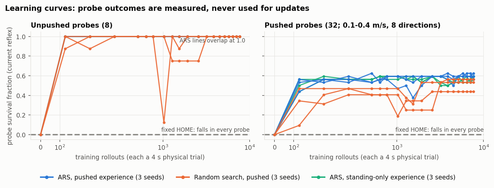
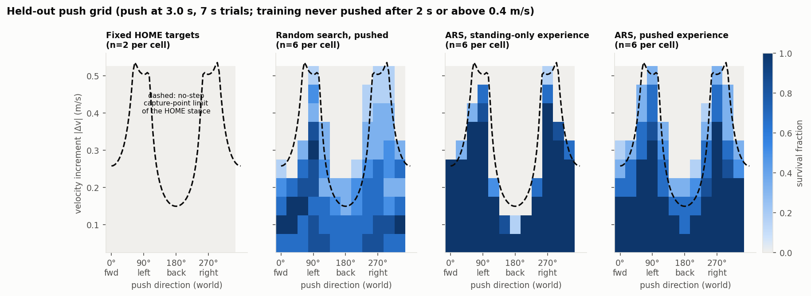
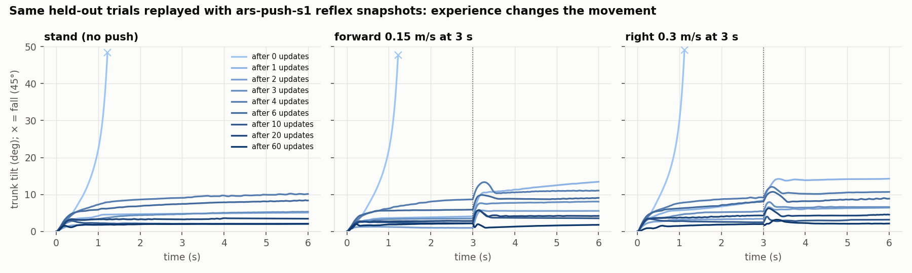
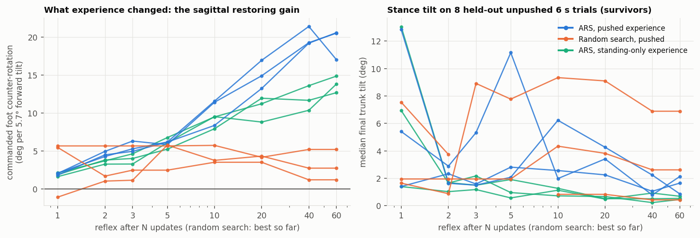
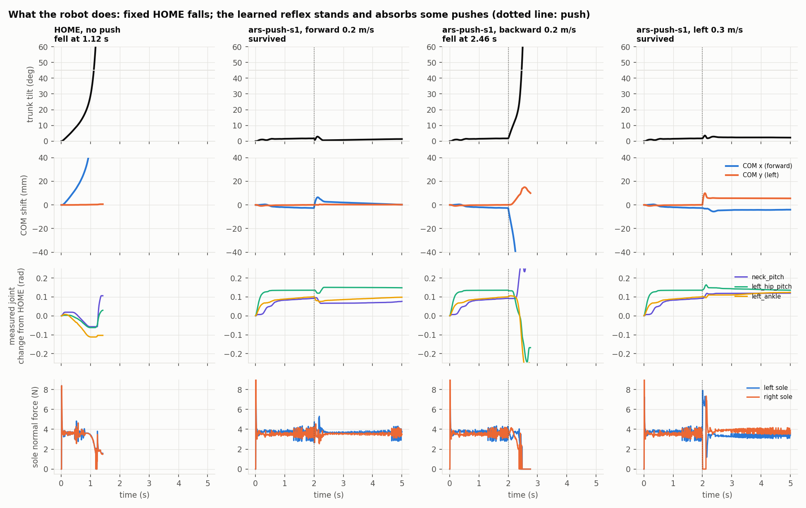
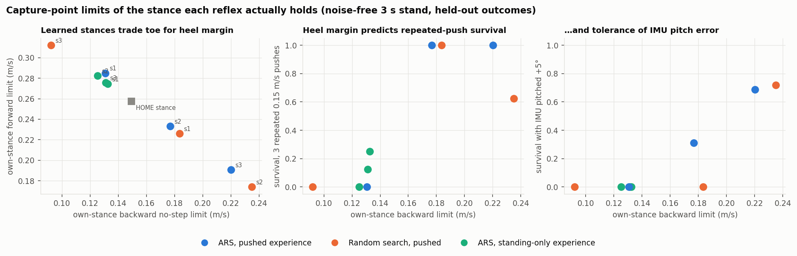
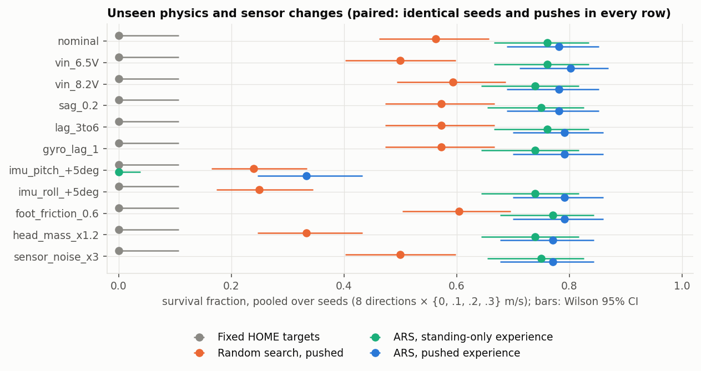
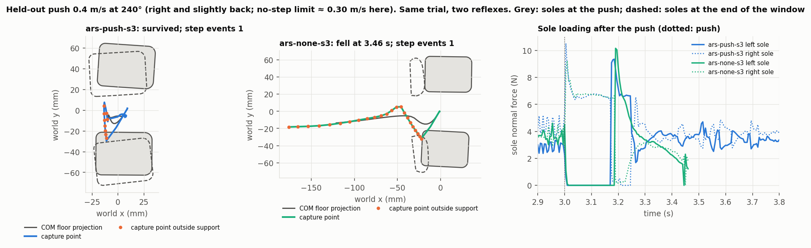

# Movement Lab 02B — Learning to React

**Question.** Can experience improve the robot's movement itself, not just which experiment runs next?

**Short answer: yes, and the physics says precisely how far.**

- **Learning to stand.** With fixed HOME targets, Microduck falls in 1.1 s with no disturbance. An 84-number linear reflex from onboard IMU readings to its 14 servo targets learns to stand after a single update, in all 6 ARS runs and 2 of 3 random-search runs (the third needs two). One update is 128 physical trials.
- **What experience changed.** It built a sagittal tilt → leg-joints reflex whose restoring gain grew about 10×.
- **What being pushed changed.** It moved *where the robot stands*. Two of three push-trained ARS reflexes lean about 1–2° so the centre of mass sits nearer the middle of the soles, gaining heel margin at the cost of toe margin. Every standing-only reflex chose the most upright, heel-poor stance.
- **What the physics predicts.** Measured against the stance each reflex actually holds, the no-step (capture-point) limit predicts held-out survival almost perfectly: **3 survivals out of 818 pushes beyond it**, across all nine learned reflexes.
- **What did not get past it.** Experience made reflexes better *inside* that limit. Neither more targeted experience beyond it nor extra proprioceptive capacity got the robot past it, and no stepping strategy emerged.
- **Controls.** Adaptive search beat matched random exploration clearly.

Everything here is CPU simulation of the upstream model. No hardware was used (see *Hardware feasibility*).

| | |
|---|---|
|  |  |

## What the controller is

| | |
|---|---|
| **Senses** | Only an onboard IMU, as upstream's actor sees it: projected gravity x/y (trunk tilt) and gyro x/y/z, with upstream's uniform sensor noise (±0.01, ±0.03 rad/s). No joint encoders, contact, time, phase or command. |
| **Acts** | Position-target offsets from upstream HOME on all 14 servos (legs *and* neck/head), clipped to ±0.35 rad and 0.02 rad inside joint limits, at 50 Hz through the unchanged BAM XL330 M6 model (7.35 V, 0.1 V/Nm sag, 6 V floor, stiff friction, ±0.957 Nm) with mjlab's 4-physics-step command delay. |
| **Form** | `offset = W · s + b`. W is 14 × 5 and b (the posture bias) is 14, so 84 numbers in all. Features are scaled so one unit = 0.1 of gravity (about 5.7° of tilt) or 1 rad/s. **θ = 0 is exactly the fixed-HOME baseline.** |
| **Changes through experience** | W and b, between trials only, by Augmented Random Search (ARS V1-t). Each update evaluates 16 antithetic ±0.03 perturbations on the same 4 physical trials and steps along the 8 most informative. Nothing changes within a trial. |
| **Scored by** | `(alive steps − 0.5·Σ(tilt/45°)² − 0.02·Σ‖offset/0.35‖² − 0.05·Σ‖Δoffset/0.1‖²) / steps`. A fall ends scoring: tilt > 45° or root-height loss > 4 cm (00C's survival rule), or any non-sole floor contact (curated groundcontact model). Survival dominates by construction (unit-tested). |

## Design

**Starting point.** The upstream curated-groundcontact model, compiled by upstream mjlab exactly as 01A–02A configured it (`model02b`, byte-identical on recompile). It starts from 01B's geometry-derived 1 mm sole-clearance reset, which this code reproduces to 5×10⁻¹⁰ m. With fixed HOME targets the robot topples **forward over its toes**: tilt crosses 45° at 1.12 s, both soles stay in contact, and peak torque is only 0.098 Nm. The servos are not saturated. They are too compliant to hold the posture. This matches 01A's "zero action also falls". So there is no passive balance to improve on, and the first thing experience has to produce is standing.

**Arms.** Each arm has 3 seeds, an identical budget (7,680 trials of 4 s), identical physics, start θ = 0, and the same training trials at each iteration.

| Arm | What chooses the next experiment | Experience |
|---|---|---|
| `ars-push` | outcomes of the previous perturbations (adaptation) | standing + one random horizontal push per trial (0–0.4 m/s root-velocity increment, 00B/00C semantics, at 1–2 s) |
| `random-push` | nothing: 32 independent random reflexes per iteration (log-uniform scale 0.01–0.3), best kept; top 10 re-scored on 16 fresh trials at the end (+160 trials) | same as `ars-push` |
| `ars-none` | adaptation | standing only: same seeds and initial joint noise, pushes drawn and discarded |
| `home` | — | none (θ = 0) |

**Observation without leakage.** Each run has a fixed 40-trial probe set: 8 unpushed trials plus 8 directions × 0.1/0.2/0.3/0.4 m/s pushed at 1.5 s, with seeds ≥ 500M. It runs on the current reflex at iterations 0–6, 8, 10, 12, then every 5. Probe outcomes are logged and never used. Held-out evaluation uses seeds ≥ 900M, and every controller sees exactly the same conditions. Seed separation is unit-tested.

**Held-out batteries** (680 trials per controller, 6,800 in all):

| Battery | What it tests |
|---|---|
| `push_grid` | 12 directions × 0.05–0.5 m/s × 2 seeds, pushed at 3.0 s, 7 s trials. Training never pushed after 2 s or above 0.4 m/s. |
| `stand_long` | 20 s unpushed, with 2.5× the training joint noise. |
| `pulse` | Sustained horizontal force at the trunk (0.1 s or 0.3 s) or the head (0.1 s), with impulse equal to 0.1/0.2/0.3 m/s. A disturbance type never trained. |
| `repeated` | Three 0.15 m/s pushes 2 s apart in different directions. |
| `shift:*` | Eleven paired sensor and physics changes never trained: battery 6.5/8.2 V, sag 0.2 V/Nm, command-delay jitter 3–6 steps, +20 ms gyro lag, 5° IMU pitch or roll mounting error, foot friction 0.6, head mass ×1.2, 3× sensor noise. |

**Physical benchmark (`physics02b`).** A linear-inverted-pendulum capture point. A velocity change Δv moves it by Δv/ω₀, with ω₀ = √(g/h) ≈ 8.4 rad/s for a COM height h of about 0.14 m. Without stepping or upper-body momentum, the robot can stop only if the capture point stays inside the soles' convex hull. The limit along direction u is therefore ω₀ × (distance from the COM floor projection to that hull along u).

At HOME, the soles reach 31 mm ahead of the COM projection but only 17 mm behind it, and ±60 mm sideways. That gives **0.26 m/s forward, 0.15 m/s backward, 0.30 m/s on the back diagonals and 0.50 m/s sideways**. The same computation is applied to the stance each learned reflex actually holds (final state of a noise-free 3 s stand). It is a geometric estimate, not a measured stability margin, and §3 tests it.

## Results

### 1. From falling to standing in one update

Every ARS run, and 2 of 3 random-search runs, stands on all 8 unpushed probes after the **first** update (128 trials). The third random run stands after two. Replaying held-out trials with ars-push-s1's snapshots ([evolution](report/evolution.png)):

- **0 updates:** falls at 1.1–1.2 s in all three trials.
- **1 update:** survives all three, but sways up to 5–14°.
- **60 updates:** survives all three with peak tilt 2.1–3.2°, including after a 0.3 m/s sideways push.



Pushed-probe survival then plateaus within about 5 updates: 0.56–0.62 (ars-push), 0.56–0.59 (ars-none), 0.44–0.56 (random) at iteration 60. The reflex keeps changing after that. Part of the change matters physically (gain, stance; §2–§4) and part is diffusion along directions that do not.

### 2. What experience changed in the reflex

**Mechanism by ablation** (held-out nominal trials: 16 unpushed, 24 pushed at 0.1–0.3 m/s, per seed; [figure](report/ablation.png)).

- **Ingredients that alone match the full reflex:** tilt feedback, sagittal feedback (pitch tilt + pitch rate) and legs-only (no neck/head rows). Each keeps 100% standing and 67–79% pushed survival, against 71% for the full reflex.
- **Ingredients that alone fail:** the posture bias, gyro-rate feedback, lateral feedback and neck/head rows. Each stands in at most 62% of unpushed trials for one seed and in 0–25% for the others.
- **Ingredients whose removal costs nothing:** the posture bias, the mirror-asymmetric half of W (the mirror-symmetrised reflex is identical), or any one joint for seeds 2 and 3.
- **Seed 1 is concentrated:** it cannot stand without its left-knee row ([joint importance](report/joint_importance.png)).
- **The learned reflex is a proportional pitch-tilt → leg-joints response.**

A spot check after the *first* update (seed 1, a handful of trials) needed **both** the bias and tilt feedback to stand. After 60 updates, feedback alone stands and survives all four test pushes, and the held-out ablation confirms the bias is dispensable for all seeds. Experience made balance purely reactive.

**The restoring gain grew about 10×.** We translate the forward-tilt column into the commanded change of foot pitch relative to the trunk, per 5.7° of forward tilt. Positive means that, with the soles planted, the command counter-rotates the trunk toward upright.

| Arm | After 1 update | After 60 updates |
|---|---|---|
| ARS, pushed experience | +1.8 to +2.1° | **+17.0 / +20.6 / +20.5°** |
| ARS, standing-only experience | +1.6 to +2.1° | +12.7 to +14.9° |
| Random search, best | −1.1 to +5.7° | +1.2 to +5.2° |

All 9 final reflexes are correctly signed. Across the three ars-push seeds, 30 of 84 entries share a sign (21 expected by chance). Nine of those are in the forward-tilt column, including left/right-mirrored hip pitch, knee and ankle. The rest of W diffuses, which is why individual matrices look noisy ([reflex](report/reflex.png)). The angle is a *commanded* kinematic quantity: the compliant servos turn it into torque rather than motion.

**Stance tilt** on 8 held-out 6 s unpushed trials fell from 1.4–13° after 1 update to 0.45–2.1° after 60 in 5 of 6 ARS runs. ars-push-s3 stayed at about 1.5°. Random search's best-so-far improved in only 1 of 3 seeds (ending at 0.4–6.9°).



### 3. The held-out push boundary is the stance's capture-point limit

Held-out push grid, pooled over 3 seeds (720 trials per arm):

| | HOME | Random search | ARS standing-only | ARS pushed |
|---|---:|---:|---:|---:|
| all pushes | 0/240 | 270 (37.5%) | 358 (49.7%) | **385 (53.5%)** |
| per seed | — | 48.3 / 43.3 / 20.8% | 50.0 / 49.2 / 50.0% | 50.4 / 56.2 / 53.7% |
| inside **own-stance** no-step limit | — | 268/444 (60%) | 358/446 (80%) | **384/452 (85%)** |
| beyond own-stance limit | — | **2/276** | **0/274** | **1/268** |
| survivors returning to quiet upright stance | — | 113 / 270 | 358 / 358 | 385 / 385 |

Across all nine learned reflexes, **3 of 818** pushes beyond their own stance's no-step limit were survived. The survival region of both ARS arms traces the capture-point curve in every direction ([push grid](report/push_grid.png), drawn against the HOME stance). It is deep sideways (to 0.45–0.5 m/s), shallow backward and intermediate forward.

That shape is not a property of the learner. It is sole geometry: 17 mm of heel against 31 mm of toe at HOME. The backward failure is visible in [response](report/response.png) and the replay, where the robot rotates about its heel edge until it lands on its back.

Learning determines **how much of the region inside the limit** is actually recovered: 85% / 80% for ARS against 60% for random search. Random-search winners also **survive without recovering**. 157 of their 270 survivors end leaning (median 9°) and still moving (median peak 0.6 rad/s), whereas every ARS survivor returns to a quiet stance (final second < 5° and < 0.5 rad/s).



### 4. What being pushed taught: where to stand

The stance each reflex holds sets its limits. Forward and backward limits trade off along a line, because the soles' length is fixed ([margins](report/margins.png)):

| Own-stance limit (m/s) | Forward | Backward | Back diagonals |
|---|---:|---:|---:|
| HOME stance | 0.26 | 0.15 | 0.30 |
| ARS standing-only, s1/s2/s3 | 0.28 / 0.28 / 0.28 | 0.13 / 0.12 / 0.13 | 0.25–0.27 |
| ARS pushed, s1 / **s2** / **s3** | 0.28 / **0.23** / **0.19** | 0.13 / **0.18** / **0.22** | 0.26 / **0.35** / **0.44** |
| Random search, s1 / s2 / s3 | 0.23 / 0.17 / 0.31 | 0.18 / 0.24 / 0.09 | 0.37 / 0.47 / 0.18 |

- **Standing-only ARS** found the same thing in all three seeds: the most upright stance (median tilt 0.45–0.68°), with the COM close to the heel edge.
- **Two of three push-trained ARS reflexes** stand leaning about 1–2° (median 0.85–1.6°), moving the COM toward the middle of the soles. That gains 35–70% more heel margin at the cost of toe margin.
- **The overall push grid barely notices this trade** (Spearman ρ = 0.19 across the nine reflexes), because total margin is conserved.
- **Heel-loaded disturbances do notice it.** Heel margin predicts survival of three repeated 0.15 m/s pushes (ρ = 0.86, p = 0.003) and of a 5° IMU pitch error (ρ = 0.77, p = 0.015).

This is the clearest effect of disturbance experience, and it is a change of *posture*, discovered through falling, not a change of reaction speed.



### 5. Adaptation vs random exploration; pushes vs no pushes (paired)

On the 720 identical held-out push-grid trials, discordant pairs (survived with one controller only) are:

- **ars-push vs random-push: 165 vs 50** (exact McNemar p = 1.5×10⁻¹⁵).
- **ars-none vs random-push: 135 vs 47** (p = 4.7×10⁻¹¹).
- **ars-push vs ars-none: 67 vs 40** (p = 0.012). All 3 seed pairs point the same way, by +0.4, +7.1 and +3.7 points.

These trial-level tests describe *these* nine controllers. With 3 training seeds per arm, the procedure-level claim rests on seed consistency rather than on these p-values. In short:

- **Adaptive search clearly outperforms matched random exploration.** This is the comparison 02A could not resolve.
- **Being pushed during learning helps somewhat** beyond learning to stand at all, mainly through the stance shift in §4 and a stronger restoring gain.

### 6. Generalisation to unseen conditions



| Pooled over 3 seeds | Random search | ARS standing-only | ARS pushed |
|---|---:|---:|---:|
| 20 s stand, 2.5× joint noise | 16/24 | 24/24 | 24/24 |
| trunk force pulse 0.1 s | 46/72 | 55/72 | **63/72** |
| trunk force pulse 0.3 s | 48/72 | 61/72 | **68/72** |
| head force pulse 0.1 s (same impulse) | 19/72 | 29/72 | 32/72 |
| three repeated pushes | 13/24 | 3/24 | 16/24 (0/8, 8/8, 8/8 by seed) |
| nominal shift grid | 54/96 | 73/96 | 75/96 |
| **IMU pitch +5°** | 23/96 | **0/96** | 32/96 (0, 10, 22 by seed) |

- **Robust shifts.** The ARS reflexes are essentially unaffected by battery voltage 6.5–8.2 V, voltage sag, command-delay jitter 3–6 steps, an extra 20 ms gyro lag, 3× sensor noise, foot friction 0.6, a 20% heavier head or a 5° IMU roll error. Each stays within ±2 of the 96 nominal-grid trials, pooled.
- **The one catastrophic shift: a 5° IMU pitch mounting error.** A reflex built on tilt feedback reads a constant false tilt and servos toward a stance that is 5° wrong.
  - It kills every heel-poor reflex, including all standing-only ones. Heel-margin stances partly tolerate it (§4).
  - Upstream notes the real board has a systematic ~5° pitch offset, corrected at runtime. For this controller that calibration is not optional.
- **Head pushes are harder.** A force pulse at the head is harder than the same impulse at the trunk; it plausibly also applies a torque about the COM.
- **Random winners are fragile.** They break under conditions the ARS reflexes ignore: random-push-s2 fails all 32 head-mass trials and 16 of 32 at 6.5 V.

### 7. Foot lift-offs near the limit, not a stepping strategy

1,011 held-out trials include conservative step evidence: a sole unloaded ≥ 40 ms that lands > 5 mm away (00C's rule). Most are in falls. Among survivors they occur almost only for 0.25–0.5 m/s pushes with a sideways component: one sole unloads for about 0.1–0.2 s and lands about 1 cm (at most 3.4 cm) away.

Judged against the HOME stance, some of these survivals looked like recoveries beyond the no-step limit. Against each reflex's own stance, **every** survival with such an event is inside the limit.

The [step-event figure](report/step_event.png) shows one held-out trial (0.4 m/s at 240°):

- **Both reflexes lift a foot.** ars-push-s3 and its standing-only sibling both lift the left sole for about 0.16–0.18 s and land it 12–16 mm away.
- **Only the heel-margin stance recovers.** ars-push-s3, whose back-diagonal limit is 0.44 m/s, brings the capture point back inside its support within 0.18 s and survives. The standing-only reflex (0.26 m/s limit) has its capture point outside support for 0.46 s and falls at 3.46 s.

The lift-off is a passive consequence of rolling onto one sole, so there is no learned stepping strategy here.



### 8. Targeted revision: experience beyond the limit, with and without extra capacity

Because the plateau sits at the physical wall, we asked whether it reflects the reflex's capacity or the physics. Seed-1 pilot, both arms warm-started from ars-push-s1 with identical ARS settings (32 directions × 8 trials), seeds and budget (12,800 trials). Training saw *only* hard pushes (0.15–0.45 m/s, mostly beyond the limit).

- **linear:** the same 84-number reflex, more targeted experience.
- **residual:** the same reflex plus a zero-initialised residual network over the IMU and noisy joint positions/velocities (852 parameters). It starts exactly at the warm-start reflex.

| Held-out push grid (240 paired trials) | Survived | Inside own limit | Beyond own limit |
|---|---:|---:|---:|
| warm start (ars-push-s1) | 121 | 120/148 | 1/92 |
| linear, hard experience | 131 | 131/152 | 0/88 |
| residual, hard experience | 132 | 132/146 | 0/94 |
| residual arm with residual removed | 125 | 125/152 | 0/88 |

- **Targeted experience helped a little, and only inside the limit.** Linear vs warm start: 15 vs 5 discordant, p = 0.041. The revision also shifted stances slightly toward more heel margin (backward limit 0.13 → 0.15–0.17 m/s).
- **Extra capacity added nothing measurable.** Residual vs linear: 11 vs 10 discordant. No new behaviour appeared: the probe curves are flat and step counts are unchanged.
- **Nothing got past the limit.** Within these budgets, the own-stance no-step limit binds a reactive reflex absolutely. Going past it needs the robot to do something it never discovers here: place a foot on purpose. ([revision](report/revision.png))

### 9. Fidelity cross-check against upstream's own stepping path

Learning used native CPU MuJoCo with `bam.mujoco`, because this Windows venv's PyPI torch is CPU-only and mjlab's CUDA path cannot run. We replayed four controllers on 25 noise-free conditions (stand + 8 directions × 0.1/0.2/0.3 m/s) inside upstream's own `ManagerBasedRlEnv`: MuJoCo-Warp on CPU, torch BAM actuator, mjlab delay buffer.

- **Model and initial state:** model fields identical, initial states equal to 1.2×10⁻⁸.
- **Outcomes agree in 99 of 100 trials.** HOME 25/25 falls, ars-push-s1 25/25, random-push-s1 25/25, ars-none-s1 24/25. The one disagreement is a 0.3 m/s push at 45°, near the boundary.
- **Trajectories:** surviving tilt traces differ by a median 0.2–1.2° RMS (2,233 s).

Near-boundary outcomes are solver-sensitive; the boundary itself transfers.

## Physical integrity

| Check | Result |
|---|---|
| Actuator saturation | No held-out trial reached 98% of the BAM torque limit. Peak torque was ≤ 0.32 Nm (limit 0.957). |
| Penetration | ≤ 2.2 mm while standing, inside the 3 mm gate. All 6,800 held-out trials are valid. |
| Joint limits | Respected with a 0.02 rad margin. |
| Upstream | Untouched. No upstream file was edited and no upstream training ran. |
| Prior studies | Unchanged. |

## Hardware feasibility (what transfers, what doesn't)

**Encouraging:**

- The controller needs only an IMU and position-controlled servos, both of which the robot has.
- It uses about a third of the modelled torque.
- It tolerates voltage, delay jitter, gyro lag, noise, friction and head-mass changes in simulation.
- It is 84 numbers, trivially deployable at 50 Hz.

**Not established:**

- Real XL330 compliance, backlash, encoder bias and contact behaviour. The `-Backlash-` models were not used.
- IMU pitch calibration, which this reflex is acutely sensitive to (§6).
- Real push magnitudes. A root-velocity increment is a reproducible momentum disturbance, not a measured force.
- Whether the HOME-falls-forward property, and the sole margins that set every limit here, hold on the physical robot. Both depend on modelled servo stiffness and sole geometry.

**Bottom line.** This is simulated success under the upstream model, not hardware evidence. It is a candidate for a short, safe hardware probe (held, with a calibrated IMU) before any claim.

## Limitations and uncertainty

- **Seeds and pilot size.** 3 training seeds per arm; the revision is a single-seed pilot. Trial-level p-values do not cover training-procedure variance. Stance correlations use n = 9 reflexes.
- **Tunable thresholds.** Survival and recovery thresholds, the score weights, the ±0.35 rad action bound and the learner's hyperparameters were fixed before the main runs (pilots informed them; see [ATTEMPTS](ATTEMPTS.md)). Other choices could shift absolute numbers.
- **The capture-point bound is a model.** It is a linear-pendulum, rigid-sole, static-stance estimate. The own-stance bound was computed after the evaluation, as an analysis, not preregistered. It uses each reflex's noise-free stance, while evaluation trials add noise.
- **Disturbance semantics.** Pushes are instantaneous root-velocity increments (00B/00C semantics). Pulses are applied at body COMs. Neither is a point contact on a shell.
- **Simulator differences.** CPU MuJoCo and MuJoCo-Warp differ near boundaries (§9). Evaluation is deterministic within this software stack, and bitwise identity across machines is not claimed.
- **The reflex is memoryless and linear by design.** "No stepping emerged" is a statement about this controller class and these budgets, not about Microduck.

## What next (left open)

The experiment points somewhere specific. Reactive experience gets the robot to stand, and then fills in the region its stance allows. Push experience additionally discovered that *where you stand* decides which pushes you can absorb.

The sole gives about 41 mm of fore-aft support in total. Every further gain in sagittal tolerance therefore has to come from **changing the support**: placing a foot. That needs a controller that can sequence (memory, phase, or a trigger), and an experience stream that rewards recapturing the capture point rather than merely surviving.

Equally open:

- **Calibration-free balance.** Bias-robust tilt sensing, or online estimation of the IMU offset.
- **Active stance selection.** Shifting the COM toward the threatened edge once a push is sensed.
- **Upper-body momentum.** The heavy head could provide it, but no learner here found the neck/head rows useful.

Whether the next study is "learning to step", "learning where to stand", or something the robot shows us first is for the evidence to decide.

## Reproduction

From the movement-lab root with the upstream venv (`PYTHONPATH=. PYTHONUTF8=1`):

```bash
PY=~/microduck_rl/.venv/Scripts/python.exe      # Linux: .venv/bin/python
$PY -m movement_lab.model02b --out results/02b/model         # ~20 s; local 81 MB MJB (ignored), installed only if it matches model.json
$PY -m movement_lab.study02b train --root results/02b        # 9 runs, 62 min on 12 threads
$PY -m movement_lab.study02b evaluate --root results/02b     # 6,800 held-out trials, 10 min
$PY -m movement_lab.study02b ablate --root results/02b       # 3,000 trials, 7 min
$PY -m movement_lab.study02b revise --root results/02b --seeds 1            # 2 × ~12 min
$PY -m movement_lab.study02b evaluate-revision --root results/02b --seeds 1
$PY -m movement_lab.study02b crosscheck --root results/02b   # mjlab on CPU, ~37 min
$PY -m movement_lab.analysis02b --root results/02b && $PY -m movement_lab.replay02b --root results/02b
$PY -m movement_lab.validate02b --root results/02b --resimulate 24
$PY -m movement_lab.publication02b --root results/02b --verify
$PY -m unittest tests.test_react02b -v
```

On a fresh checkout `results/02b/model` already holds the published `model.json`; `model02b` then compiles into a temporary directory, checks the result against it, and installs only a matching `model.mjb`.

**Cost.** Measured wall time was 8,556 s for training, evaluation, ablation, revision and cross-check (the cross-check overlapped other steps), plus about 25 min of pilots and analysis. Training used 69,600 physical trials, the revision 25,600, and held-out evaluation 10,888.

**Validation (`validation.json`)**, all passing:

- model hash;
- every run's exact budget, probe schedule and final snapshot;
- completeness of the evaluation table, with seeds disjoint from training and probes;
- evaluated reflexes identical to run finals;
- aggregates recomputed from the 6,800 rows;
- 24 random held-out trials re-simulated bit-identically in a fresh process.

**Files.**

- `manifest.json` hashes every artifact and the 02B sources (SHA-256 of the exact bytes). Published text is LF on every platform (`.gitattributes` pins it), so the same hashes verify on Linux and Windows checkouts. Local-only items: the compiled model (upstream meshes), logs, raw `results.jsonl` (published as deterministic `.gz`) and mesh renders.
- `report/tables.json` holds every number quoted here.
- The [replay](report/replay.html) is a portable stick-figure playback of recorded states (no meshes): HOME falling, the reflex standing and being pushed, and the step-event pair.
- Mesh renders for visual inspection were made locally and are not published (upstream CC BY-NC-SA assets).
