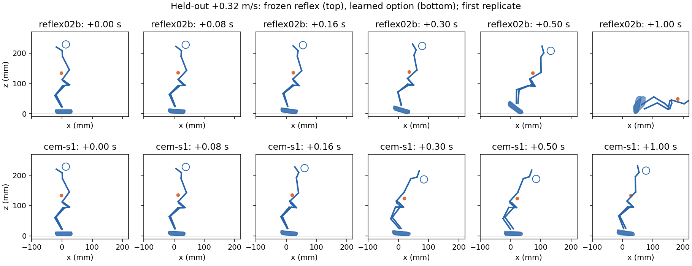
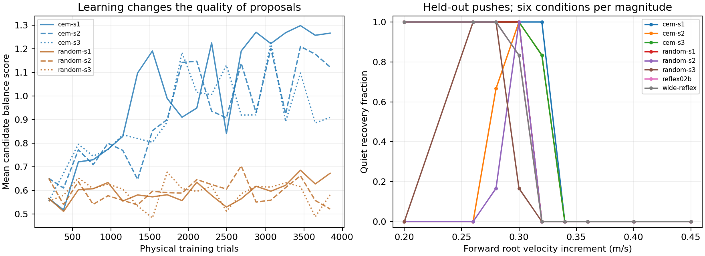
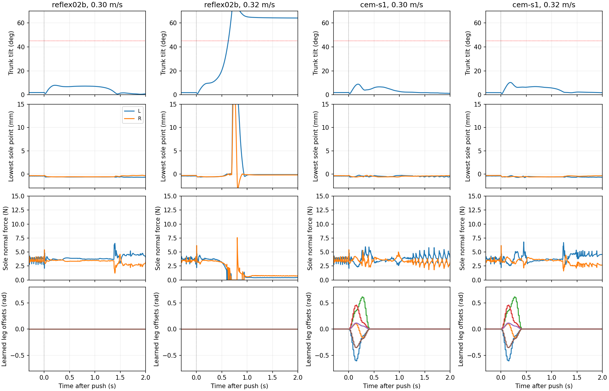

# Movement Lab 02C — Learning to Move

**Question:** Can experience turn balance recovery into purposeful movement?

**Experience produced a useful, timed whole-body recovery motion, but did not
produce a recovery step, hop, or controlled travel.** A learned 0.4 s head-and-leg
sequence rescues disturbances that defeat the unchanged 02B reflex. Its timing
and joint coordination matter in paired interventions. Both soles remain on the
floor in every successful main-grid pushed trial of the three learned controllers.

The gain is narrow. At a forward velocity increment of **0.32 m/s**, the three
learned controllers recover in **6/6, 5/6 and 5/6** held-out conditions. The frozen
reflex and its expanded-action control recover in **0/6**; all three matched
random-search winners recover in **0/6** each. None of the learned controllers
recovers at 0.34 m/s or above in the main grid. One also fails every smaller
0.20/0.26 m/s push: a stronger fixed response can make an easier problem worse.

This is evidence for learned temporal motor coordination, not for learned
support relocation. It also revises the motivating premise: 02B's approximate
capture boundary was not the full limit of motion with continuous sole contact.

Frozen reflex above, learned seed 1 below, first held-out replicate at 0.32 m/s.
The learned response bends briefly and returns; the baseline falls. Blue lines
are body-frame connections, the circle is head COM, orange is whole-body COM,
and sole silhouettes use measured positions. This is a schematic, not a mesh
render. [Open the interactive replay locally](report/replay.html) to inspect
35 fixed examples, including seed 2's failures and larger disturbances.

## What was allowed to change

The frozen `ars-push-s1` reflex from 02B supplies quiet standing. A learned option
adds a short sequence of joint targets after a disturbance cue, then hands back
to that same reflex. The final representation has two free waypoints for each
of all 14 servos: 28 learned numbers, smoothly traversed in 0.4 s. Search starts
from zero residual with a zero-centered random proposal. Neither the side to
lift nor a foot trajectory,
step length, direction of travel, gait, or final body location is specified.

The learner receives balance outcomes, not distance or foot-lift credit. Its
score combines upright survival and a full final second of quiet recovery.
Quiet requires tilt <5°, angular speed <0.5 rad/s, and horizontal root speed
<0.05 m/s. A quiet half-second before the push is also required. Falling, a
nonfoot floor contact, >3 mm penetration, or >4 cm height loss latches failure.
Evaluation additionally requires supporting foot contact, summed normal force
>0.5 N and total 3-D root speed <0.05 m/s throughout the final second, and rejects
measured joint-limit overshoot >0.03 rad. A late replant cannot erase a fall.

The option gets an **oracle disturbance-onset cue**. This is an experiment in
learning a motor response, not autonomous learned detection. The standing
reflex continues to sense noisy IMU gravity and angular velocity throughout.
A separate fixed-threshold IMU trigger and 80 ms delay test how dependent the
learned action is on that cue. The residual itself sees neither contact nor
joint state, and cannot adapt its waypoints to disturbance magnitude.

Joint offsets can now reach 0.8 rad, compared with 02B's 0.35 rad; the standing
reflex is still clipped exactly as before. All joint targets retain the existing
0.02 rad joint-limit margin. Upstream motor torque, voltage sag, friction,
armature, collision geometry, solver and 20 ms command delay are unchanged.

## Experiment, controls and held-out conditions

The [protocol](PROTOCOL.md) records the alternatives considered and the initial
pilot. Four waypoints over 0.8 s found a narrow recovery improvement but no
verified step. Hard randomly sampled batches sometimes erased evidence of
successful responses. The revision halved the response duration and parameter
count, and stratified each training batch over easier and harder pushes. It
improved the evidence stream without visibly moving the pilot's physical
boundary. These changes are bundled, so their separate contributions cannot
be inferred from the pilot comparison.

Confirmation uses three independently initialized CEM searches and three paired
nonadaptive random searches. Each gets **3,840 trials**: 20 generations × 48
candidates × four conditions. They share the same condition seeds within a
training-seed pair, the same starting point and initial proposal distribution,
and the same incumbent-rescoring rule. Only CEM moves its proposal distribution
toward successful candidates. All runs use their **last training winner**; no
held-out result chooses a checkpoint.

Training: four-second episodes, forward root-velocity increments 0.28–0.36 m/s,
onset 1.2–1.8 s, initial joint noise ±0.01 rad, upstream IMU noise. Confirmation:
six-second episodes, later onset 2.2–3.2 s, ten magnitudes from zero to 0.45 m/s,
six independent conditions each. Seeds are disjoint from all training and pilot
conditions. The push changes root velocity, not position or motor commands.
It is a reproducible momentum intervention, not a measured applied force.

Controls remove the learned option, reverse its waypoint order, replace both
waypoints with their mean, remove the head or leg part, delay it by 80 ms, or
trigger it from a fixed IMU threshold. No-push and forced-response-without-push
trials test spontaneous movement and whether the action simply improves the
standing posture. Friction, voltage, delay and IMU-offset batteries check a
limited set of distribution shifts.

The main experiment contains **23,040 training trials** and **2,190 held-out
evaluation trials** (1,740 main grid, 432 shifts, 18 forced responses without a
push). The two development pilots add 5,760 training trials, for **28,800 total
training trials**. Six confirmation runs took 29.2 minutes of sequential wall
time; pilots took another 8.7 minutes. These are training times, excluding
evaluation, compilation, development probes and visualization.

## What experience changed

| Controller | All 60 conditions | Pushed 54 only | Training band 0.28–0.36 m/s, 30 conditions |
|---|---:|---:|---:|
| Frozen 02B reflex | 29 | 23 | 11 |
| Same weights, reflex clip widened to 0.8 rad | 29 | 23 | 11 |
| CEM seed 1 | 36 | 30 | 18 |
| CEM seed 2 | 21 | 15 | 15 |
| CEM seed 3 | 35 | 29 | 17 |
| Random search seed 1 | 30 | 24 | 12 |
| Random search seed 2 | 13 | 7 | 7 |
| Random search seed 3 | 19 | 13 | 7 |

Entries are quiet recoveries, not merely upright endpoints. All eight controllers
pass all six no-push trials, where no option is triggered. CEM beats the matched
random-search winner in each seed pair: 36 versus 30, 21 versus 13, 35 versus 19.
Within the targeted training band the aggregate is 50/90 versus 26/90. Random
search still selects from experience; this comparison isolates the benefit of
adapting the proposal distribution, not learning versus an unselected random
action. Candidate quality rises under CEM, while nonadaptive proposals remain
poor on average.

Left: mean candidate score on each fresh training batch, not held-out performance.
Right: all pushed main-grid conditions. The six no-push cases per controller
(all successful) are omitted from this plot because they do not execute a response.

Relative to the frozen reflex, seeds 1/2/3 rescue 7/6/6 paired cases and lose
0/14/0 cases. Seed 2's regressions include all twelve 0.20/0.26 m/s cases, outside
the trained magnitude range. It is not a generally better stabilizer. The same
54 pushed conditions are reused across controllers, and there are only three
optimizer seeds: pooled counts are descriptive, not independent replications or
a population-level significance claim. Every result uses the final training
winner; no favorable checkpoint or seed is substituted after evaluation.

All 54 pushed pre-event states are exactly identical across the 29 main-grid
controllers. The old reflex with a wider clip has identical recovery outcomes
to the original. The gain therefore cannot be attributed just to a different
starting posture or widening the old controller's action envelope.

## Does the learned sequence cause the gain?

The clearest intervention is at 0.32 m/s, where every baseline trial fails.
Each entry below is the number recovered out of the same six conditions.

| Intervention | Seed 1 | Seed 2 | Seed 3 |
|---|---:|---:|---:|
| Full learned option | 6 | 5 | 5 |
| Reverse the two waypoints | 0 | 0 | 0 |
| Replace both waypoints by their mean | 0 | 1 | 0 |
| Keep learned legs only | 1 | 0 | 0 |
| Keep learned head only | 0 | 0 | 0 |
| Clip combined offsets back to 0.35 rad | 0 | 0 | 1 |
| Delay the option by 80 ms | 0 | 0 | 0 |
| Fixed IMU threshold instead of onset cue | 5 | 3 | 5 |

All interventions preserve the standing reflex. Reversal retains the same
waypoints but changes their order; the constant control retains their mean.
Their failures show that the discovered temporal pattern matters. Neither head
nor legs alone reproduces the full benefit at this magnitude. Wider offsets
are usually necessary for these learned sequences, although widening the old
reflex alone does nothing. These are interventions on complete responses; they
do not identify one joint or a unique physical mechanism.

The IMU trigger retains 13/18 recoveries at this magnitude. It is a hand-set
threshold on pitch-axis gyro magnitude (>0.5 rad/s, armed after 0.8 s), not a
learned detector. Adding a fixed 80 ms delay removes the gain. Timing is a
material limitation even when the motor sequence itself is useful.

When forcibly executed at 1.5 s without a disturbance, seeds 1/2/3 recover in
0/6, 0/6 and 3/6 cases. All other cases fall. The response is therefore not a
generic posture improvement or a stable motion primitive that can simply be
repeated. This result also explains why event gating and disturbance-dependent
amplitude are promising next changes.

## What counts as a step

The independent audit uses every 5 ms sample, although training gates are
sampled every 20 ms. A foot must be contact-free for at least 40 ms, attain
>2 mm minimum-sole clearance, recontact >5 mm away, and stay in contact for
at least 100 ms with average normal force >0.5 N. An event counts as a recovery
step only if the whole episode remains physically valid and quietly recovers.
Foot origin displacement alone never passes this test.

This is stricter than 02B's contact-transition descriptor. It rejects contact
flicker, rocking without clearance, sliding, and a fall that happens to replant
a foot. The replay and continuous diagnostics remain necessary: thresholds are
descriptive, not proof of intent.

**There are zero verified recovery steps in all 2,190 evaluation trials.**
In contrast, 843 failed trials contain a lift/replant event satisfying the local
airtime, clearance, displacement and recontact rules. Counting those events
without the whole-episode recovery gate would create a large false discovery.

Across the 74 successful main-grid pushed trials of the three full CEM controllers,
the highest minimum-sole clearance is still slightly negative (−0.029 mm under
the soft-contact model). Thus the negative stepping result is not a near miss
at the chosen 2 mm threshold. Foot-frame displacement reaches 10.6 mm, but an
elevated ankle frame can move during rocking and sliding; that is not evidence
of a swing foot or purposeful translation.
The 72 successful pushed trials under the shift battery include brief contact
transitions, but their maximum minimum-sole clearance is only 0.080 mm. None
qualifies as a recovery step.

At the fixed first 0.32 m/s replicate, frozen and learned seed 1 have identical
motion for the first 40 ms after the cue. Their sole material contact-point
path lengths are 1.87/1.83 mm (left/right) during this interval: **the initial
slide is passive**. The learned response then differs and succeeds. It has
another 4.97/3.79 mm of contact-point travel over the rest of the first second,
with uninterrupted geometric contact. These are integrated tangential speeds,
not net travel or force-weighted slip. See [contact diagnostics](report/contact-diagnostics.json).
The historical `loaded_path_m` field in the result tables instead measures
foot-frame path while contact exists; it must not be interpreted as material
slip or a force-gated quantity.

The intervention establishes that learned actuation changes the recovery
outcome. It does not establish whether COM motion, internal angular momentum,
rocking, or compliant sliding is the dominant cause, nor whether sliding is
necessary. The developmental torque/work diagnostic and its limitations are
recorded in [ATTEMPTS.md](ATTEMPTS.md). No measured motor saturation in that
example proves that stepping is physically feasible.

The capture estimate at the actual held-out starting stances is roughly
0.284–0.290 m/s. Even the frozen reflex recovers five main-grid cases more than
0.005 m/s beyond its estimate. A pendulum approximation is useful context, not
a hard no-step theorem for this articulated, compliant model. The stronger
evidence for improvement is the matched baseline failure at 0.32 m/s.

## Failures and limits

The shift battery uses three conditions at each of 0.28/0.32/0.36 m/s; each row
below contains nine cases per controller. Conditions are paired across shifts.

| Condition | Frozen reflex | CEM 1 | CEM 2 | CEM 3 |
|---|---:|---:|---:|---:|
| Nominal, separate held-out seeds | 3 | 6 | 2 | 5 |
| Sole friction 0.6 | 3 | 6 | 3 | 6 |
| Sole friction 1.4 | 3 | 5 | 4 | 4 |
| Actuator delay 30 ms (nominal 20 ms) | 3 | 5 | 1 | 5 |
| Supply 6.5 V (nominal 7.35 V) | 3 | 0 | 3 | 4 |
| IMU pitch error +2° | 6 | 9 | 2 | 2 |

Robustness is uneven. Lower voltage destroys seed 1's recovery, while a small
IMU error improves its outcomes but hurts seed 3. The sensor offset also changes
the baseline's stance and feedback; its favorable result is not evidence of
robust sensing. Full random-search and widened-reflex results are preserved in
[recomputed tables](report/tables.json). These sparse one-factor probes do not
cover simultaneous shifts or hardware variation.

The original 0.8 s/four-waypoint approach and the revised 0.4 s/two-waypoint
pilot both failed to discover support change. The revision followed evidence
about response timing and inconsistent training batches, rather than simply
extending a stalled run. The final negative result is still specific to this
search space, reward, and budget. A diagonal Gaussian search with three seeds
does not establish that all useful contact changes are unreachable.

Several design choices may favor the solution found here. A short open-loop
option cannot adapt to contact state or push magnitude; it always returns to
the old standing reflex. Rewarding quiet standing and terminating after 4 cm
height loss can reject deep crouches and continuing controlled falls. Only
single forward disturbances on a flat floor were trained. There is no evidence
here about repeated pushes, lateral recovery, sustained travel, or a controller
whose objective permits motion at the endpoint.

## Concrete next experiments

1. **Condition response amplitude and timing on sensed state.** Start with the
   existing useful motion, supply IMU history and joint/contact observations,
   and include small pushes and false triggers in training. Keep seed 2's
   overcorrection cases as an explicit regression battery; introduce new held-out
   seeds for the next study rather than tuning on this study's final grid.
2. **Test whether support change is accessible before a larger search.** Explore
   bounded, temporally correlated joint actions from varied stable stances and
   record unloading, clearance, valid recontact and remaining fall time. This
   diagnoses an exploration bottleneck without prescribing which foot must move.
   A richer closed-loop residual or learned terminal posture can then be tested
   against this fixed option at equal physical-trial budgets.
3. **Separate the mechanics of the current gain.** Measure centroidal momentum
   and contact impulses, and compare paired friction/actuation interventions.
   Re-evaluate physical validity after each intervention. The present head/leg
   ablations identify coordination, not a uniquely identified momentum strategy.
4. **Study controlled travel as a different endpoint.** A task that permits
   bounded continuing motion needs a separate safety/recovery definition and
   tests against passive displacement. The current final-second quiet condition
   cannot answer whether controlled falling can become locomotion.

The defensible discovery is a modest one: experience can organize a transient,
coordinated action that prevents a fall beyond the old reflex's observed range.
In this investigation, that action extends the domain of continuous-support
recovery instead of becoming a step.

## Reproduction and evidence

See the [repository commands](../../README.md#movement-lab-02c--learning-to-move).
Every generation checkpoint includes all candidates, scores, outcomes, sampled
conditions, the search distribution, incumbent, and RNG state. Resuming at a
generation boundary is tested to produce identical subsequent candidates,
outcomes and winners. Individual conditions are explicit in the compressed
held-out tables. Selected raw 200 Hz trajectories and portable 50 Hz replays
contain measured states, not reintegrated animation.

The exact compiled 02B model is reused and hash-verified. It embeds upstream
meshes and remains local. Upstream Microduck is unchanged at
`b02fdea4902c2b93b7d34a83a6f05da4ececb7d3`; the study branches from merged PR #7,
`bafc45e1f03492d6cfa0d56273a158318f8f9e9e`. The GPU preflight verified actual
CUDA execution rather than inferring availability from installed packages.
Training uses two low-priority native CPU workers; the GPU is used separately
to cross-check the final options through upstream mjlab/BAM/MuJoCo-Warp.

The upstream GPU cross-check agrees on **30/30 survival outcomes**: 24 cases for
the frozen reflex and three learned controllers, plus six widened-reflex cases.
These noise-free cases have a different boundary: all learned controllers
recover 0.30 m/s and fail 0.32 m/s, while the baseline fails both. This is
backend outcome agreement on a limited battery, not trajectory identity or
universal 0.32 m/s recovery. Ten historical 02B conditions also preserve all
published survival outcomes, with small numerical fitness differences.

The full unit suite ran **109 tests with no failures**, reporting **27 skips**
(including subtests) because historical local fixtures were unavailable.
New tests cover exact zero-residual
02B equivalence, no anticipation, passive first-40-ms identity, checkpoint resume,
held-out seed separation, contact-point kinematics, and rejection of falling,
unsupported or vertically moving endpoints. The artifact validator passed
2,292 checks, including six complete budgets, source/model/baseline identities,
all search updates, paired conditions and recomputed tables; 12 sampled held-out
rows reproduce exactly on this environment. See [test log](tests.txt) and
[validation record](validation.json). The portable replay was loaded in headless
Chrome; all 35 trial choices, timeline and pause controls, and all three views
at 105 selected snapshots executed without errors. See the
[browser check](report/browser-check.json) and [verification script](report/browser-check.js),
which can run after the replay's inline script. Combined screenshot/DOM mode
stalled and was stopped; DOM-only verification completed. Static figures were
also visually inspected. Replay outlines are sampled to at most 24 points per
sole projection for file size; physical clearance uses the full convex geometry.

The complete [manifest](manifest.json) hashes published files, preserved local
development data, source modules, and the frozen baseline checkpoint. A fresh
checkout can verify the published evidence without the local development NPZs;
`--full` additionally requires those files. Numerical replay needs the separately
installed matching upstream environment and model. No hardware claim follows
from this simulation.

After review, checkpoint discovery was corrected to ignore interrupted staging
writes. The [maintenance record](ATTEMPTS.md#pr-8-checkpoint-write-review-fix)
documents the regression and its verification. The original trainer is archived
in [source-training/learn02c.py](source-training/learn02c.py); published run hashes
and numerical results retain their original provenance.
