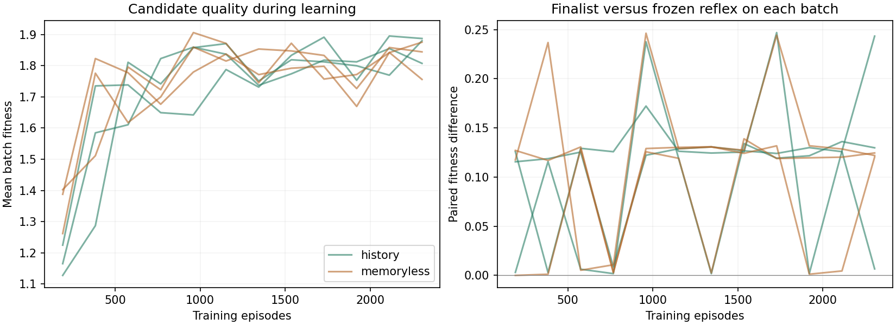
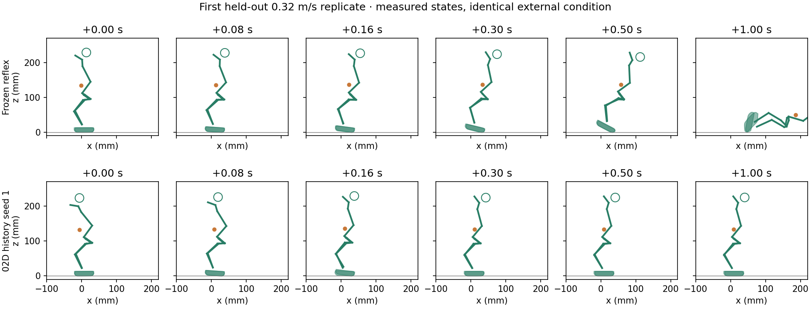

# 02D — Learning when and how to react

Microduck learned autonomous, magnitude-sensitive forward recovery using IMU
feedback. All six final learned controllers recovered all four held-out
0.32 m/s pushes, where the frozen reflex recovered none. This is a real but
limited improvement: backward pushes, quiet standing in one seed, and sensor
calibration changes exposed substantial regressions. Observation history did
not consistently improve on the simpler, equally trained memoryless control.
No recovery step or locomotion emerged.

The [private browser replay](https://movement-lab-02d-jstewdios.jstewdios.chatgpt.site)
contains synchronized recorded
states, including early learning, successful recovery, overcorrection and
failures. The [portable replay](report/replay.html) can also be downloaded and
opened directly in a browser, without hosting access.
[Protocol](PROTOCOL.md), [execution notes](ATTEMPTS.md), and
[reproduction instructions](PUBLICATION.md) accompany the evidence.

## What changed

The frozen 02B standing reflex remains active. At 50 Hz, the new controller
recomputes two signed, bounded coefficients mixing the two 14-joint waypoints
learned in 02C. It can change their strength, direction and duration instead of
executing the old 0.4-second schedule. The 22-parameter history arm uses five
current IMU channels, their 80 ms exponential history, and bias. The matched
12-parameter memoryless arm uses current IMU and bias. Neither receives event
time, disturbance magnitude, root velocity, world position or solver contact.
No gait, foot placement, step or displacement target was added.

This deliberately narrow motor vocabulary makes the experiment affordable and
interpretable; it also limits which new strategies can emerge. The IMU gravity
estimate is the inherited idealized orientation-estimator approximation, not a
verified hardware estimator. Physics runs at 200 Hz, nominal actuation delay is
20 ms, and no additional observation delay is imposed nominally. A local
controller call averaged 26 microseconds, comfortably within the 20 ms update
interval; this is not a hardware timing demonstration.

## Staged experiment and preserved baselines

The exact historical model and BAM parameters were restored and hash-checked.
All 120 declared 02C outcomes reproduced. Counts below are out of six at each
impulse magnitude, including quiet standing:

| Historical controller | Quiet | 0.20 | 0.26 | 0.32 m/s |
|---|---:|---:|---:|---:|
| Frozen 02B | 6 | 6 | 6 | 0 |
| 02C seed 1, onset oracle | 6 | 6 | 6 | 6 |
| 02C seed 2, onset oracle | 6 | 0 | 0 | 5 |
| 02C seed 1, fixed IMU trigger | 6 | 6 | 6 | 5 |
| 02C seed 1, option delayed 80 ms | 6 | 6 | 6 | 0 |

Zero residual exactly reproduces the legacy trajectory and torque arrays.
Recording is passive and repeated rollouts are deterministic. Historical code,
checkpoints and results were not edited.

The first 1,536-episode pilot improved development recovery from 16/24 to
21/24, but fell without a push. The declared quiet-regression gate rejected it.
One revision increased quiet and benign-disturbance coverage, with six-second
low-disturbance trials, while reducing population size to preserve the episode
budget. A fresh 1,536-episode pilot then achieved 20/24 versus 16/24, four paired
gains and no losses, passing the unchanged gate. Both attempts remain published.

Phase B trained three independent seeds per arm, each for 12 generations ×
16 candidates × 12 conditions = **2,304 episodes**. Training conditions were
paired across arms and included quiet standing, benign/small/moderate/strong
pushes, varied force-pulse durations, lateral/backward pushes and false gyro
alarms. Fitness retained survival, tilt and final-second settling, with a small
added-target magnitude/change penalty. Learning did not reward activity or
stepping. Both pilots plus Phase B used **16,896 training episodes**; recorded
Phase B run times total 33.6 minutes, plus 6.3 minutes for the pilots. Evaluation,
tests and rendering are additional work.

Every generation retains candidates, outcomes, distribution and exact RNG state
for deterministic resumption. Every final controller is its run's last training
winner. No seed or checkpoint was selected using held-out results.

These curves use changing training batches, not a fixed validation set; their
fluctuations are not a held-out learning curve. The replay compares generation 1
with generation 12 on the same condition: history seed 1 fails the displayed
0.32 m/s push early and recovers it later. Both checkpoints stand in the displayed
quiet trial, although the final controller adds more stance adjustment.

## Held-out recovery and regressions

The main grid contains 68 six-second conditions: 17 cells × four fresh reset/noise
seeds, with later onsets than training. The 02C seed-1 option was chosen from
the previous study before 02D; the oracle fires only for a physical disturbance.
All controls receive the same sensor corruption, including the standing reflex.

| Controller | Recovered / 68 | Paired gains / losses vs frozen | Quiet / 4 | Backward / 4 | False alarm / 4 |
|---|---:|---:|---:|---:|---:|
| Frozen 02B | 54 | — | 4 | 4 | 4 |
| 02C fixed, onset oracle | 44 | 5 / 15 | 4 | 0 | 4 |
| 02C fixed, IMU trigger | 55 | 5 / 4 | 4 | 4 | 0 |
| History seed 1 | 61 | 14 / 7 | 4 | 0 | 2 |
| History seed 2 | 57 | 8 / 5 | 4 | 1 | 2 |
| History seed 3 | 48 | 9 / 15 | 2 | 0 | 2 |
| Memoryless seed 1 | 59 | 9 / 4 | 4 | 0 | 4 |
| Memoryless seed 2 | 57 | 8 / 5 | 4 | 0 | 3 |
| Memoryless seed 3 | 61 | 10 / 3 | 4 | 1 | 4 |

At 0.32 m/s, all learned controllers recover 4/4; both 02C controls recover
3/4 and the frozen reflex 0/4. At 0.34, history seeds recover 4/2/3 and
memoryless seeds 3/2/4, versus zero for all legacy controls. At 0.36, only
history seed 1 recovers (4/4). These cells do not establish a universal boundary.
All six learned controllers recover all four repeated-push trials; the frozen
reflex and fixed IMU control also recover all four, so this is not evidence of a
new repeated-disturbance advantage. [Complete cell counts](report/tables.json)
include lateral impulses and three pulse durations.

Five learned controllers scale correction strength with disturbance magnitude.
Mean peak additional target RMS (radians) at 0.08 → 0.32 m/s is
0.095 → 0.264, 0.060 → 0.242, **0.353 → 0.216** for the history seeds, and
0.042 → 0.176, 0.039 → 0.113, 0.064 → 0.268 for the memoryless seeds.
The inverted history-seed-3 result includes failed small-push overcorrections.
Different cells use different reset/noise seeds, with four trials per estimate.

There is no imposed 0.4-second termination, but a clean discrete start/stop
strategy was not demonstrated. Some controllers retain a changed stance.
History seed 1's quiet residual RMS is 0.060–0.068 rad and horizontal root path
is 10.4–14.4 mm over 0.5–6 s, versus 4.7–7.7 mm for the frozen reflex.
Memoryless seed 3 is quieter (0.012–0.014 rad; 7.3–8.3 mm), without eliminating
extra movement. History seed 3 falls in two quiet trials; post-fall motion is
not interpreted as purposeful displacement.

## Does ongoing feedback cause the recovery?

A predeclared 72-trial diagnostic uses two additional seeds at each of
0.08/0.20/0.32/0.36 m/s. It freezes the learned residual at its last pre-push
value while leaving the standing reflex active. This oracle intervention only
removes feedback; it is not an eligible controller. All 24 paired pre-event
state checks match exactly.

| History seed | Intact / 8 | Residual frozen / 8 | History replaced by current IMU / 8 |
|---|---:|---:|---:|
| 1 | 8 | 6 | 7 |
| 2 | 6 | 4 | 6 |
| 3 | 5 | 5 | 7 |

Freezing removes both seed-1 recoveries at 0.36 and both seed-2 recoveries at
0.32. Ongoing feedback therefore contributes to these outcomes. Seed 1 still
recovers both 0.32 cases frozen, showing that the learned pre-push stance also
contributes. Seed 3 trades a gain against a loss. Replacing history does not
consistently hurt; unlike freezing, it also changes the pre-push stance, so it
does not isolate a pure memory effect. The matched trained memoryless arm is
the stronger comparison: under this budget it is more consistent across seeds.

## Limited robustness checks

Each row uses six paired trials (quiet, 0.20 and 0.32 m/s; two seeds each).
H and M list seeds 1/2/3 separately. These are limited probes, not a deployment
qualification.

| Setting | Frozen | 02C oracle | 02C IMU | History H1/H2/H3 | Memoryless M1/M2/M3 |
|---|---:|---:|---:|---:|---:|
| Nominal | 4 | 6 | 6 | 6/6/5 | 6/6/6 |
| Friction 0.6 | 4 | 6 | 6 | 6/6/5 | 6/6/6 |
| Friction 1.4 | 4 | 6 | 6 | 4/6/6 | 6/6/6 |
| Voltage 6.5 V | 4 | 4 | 4 | 1/6/1 | 6/5/6 |
| Command delay 30 ms | 4 | 6 | 6 | 6/6/6 | 6/6/6 |
| IMU delay 40 ms | 4 | 2 | 4 | 5/6/4 | 6/6/6 |
| IMU delay 80 ms | 4 | 2 | 2 | 0/3/0 | 2/5/2 |
| IMU pitch error +2° | 6 | 6 | 6 | 0/1/0 | 0/0/2 |
| Total / 48 | 34 | 38 | 40 | 28/40/27 | 38/40/40 |

Calibration error is the clearest shared weakness. Larger sensing delay also
removes much of the gain. Here delay affects both the standing reflex and new
residual, unlike 02C's option-only 80 ms delay experiment. No controller is a
uniform improvement across the tested conditions.

## Physical interpretation and validity

The evidence supports continuously adjusted coordination within the inherited
head/leg movement basis, with a contribution from altered stance. It does not
support a new stepping strategy. Across all 1,044 confirmation episodes there
are **zero verified recovery steps**. Successful learned trials have at most
0.0473 mm minimum-sole clearance and at most 10 ms contact-free intervals,
well below the unchanged >2 mm and ≥40 ms requirements. Seventy-six failed
trials contain locally qualifying lift/replant events; the whole-trial recovery
gate rejects them. All 140 trials with self-contact fail the physical audit.

Commanded joint targets and BAM torque envelopes are respected throughout.
The inherited audit retains penetration, nonfoot collision, tilt/height,
joint-limit and sustained final-second supported recovery checks. No fall is
erased by later replanting. In the displayed history-seed-1 0.32 trial, both
feet remain in contact; material contact-point paths are about 3.3/3.6 mm in the
first second, including 1.9/1.8 mm in the first 40 ms after the imposed impulse.
This is contact slip, not support relocation or locomotion. Ankle-frame motion
alone is not used to infer sliding. A causal claim of controlled weight transfer
would require further measurement/intervention.

## Evidence limits and next experiment

The suite passes **120 tests**. The final artifact audit passes **2,217 checks**,
including reconstruction of optimizer RNG/updates, budget and seed separation,
full physical re-auditing of 46 published records, and exact resimulation of one
held-out condition for each of the nine controllers. The replay samples those
real 200 Hz records at 50 Hz; schematic geometry is display-only. It preserves
failure labels from the full trial. Regression examples added after evaluation
are explicitly labeled; they did not change training or selection.
Chrome checks passed for all 46 recordings and 13 presets across three camera
views (117 sampled views), including timeline and playback controls. Both the
portable HTML and losslessly compressed hosted copy passed the same checks.

Only three optimization seeds and a small number of shared conditions were
tested. Pooled controller counts are not independent statistical replicates.
Equal episode budgets do not equate optimization difficulty: the two arms have
different dimensionality, and equal initial per-weight variance does not match
their function-space distributions. This is evidence about this representation
and budget, not a general verdict on recurrent control.

Reproduction needs the separately installed upstream environment and the exact
local compiled model. Fresh compilation produced a different binary hash and
was rejected; the previous preserved binary supplied this experiment. The cause
is unresolved and the asset-bearing binary is not bundled. Hash verification of
published evidence is portable; new simulation requires the matching model.
There is no new GPU-equivalence or hardware claim.

The next experiment should use the compact memoryless arm as a comparison and
test calibration-aware learning with explicit development acceptance gates for
quiet and backward behavior. Keep varied magnitudes and durations, independently
verify sensor-estimator effects, and require gains to survive those gates before
adding motor freedom. Further training of this study would blur its held-out
confirmation; the declared budget ends here.
