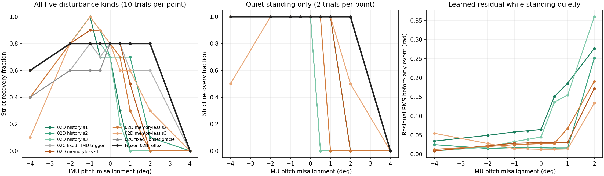
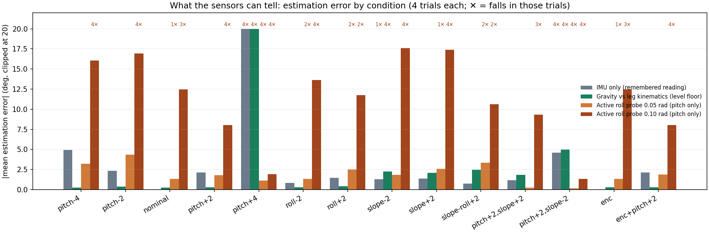
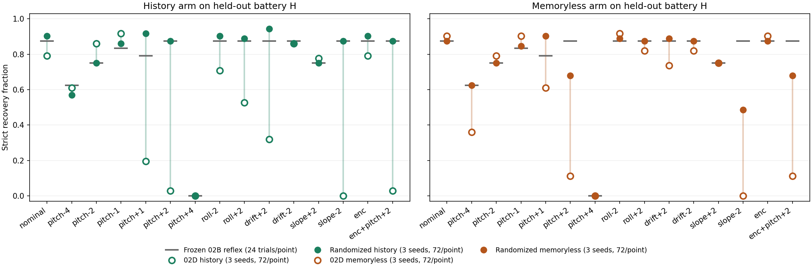

# 02E — The unreliable sense of upright

A constant IMU misalignment of two degrees is enough to make every learned 02D
controller fall while simply standing still, in 11 of 12 quiet trials; the
frozen reflex is unaffected through ±2°. The learned residuals read the offset
as a sustained disturbance cue.

- **Sensing the error.** Leg kinematics measure the offset on level ground but
  report a floor slope as a sensor offset. An active rocking probe could not
  measure it at all.
- **Calibrating before balancing.** Level-ground calibration recovered many
  misaligned trials but made two controllers fall in nominal quiet standing,
  so it failed its declared gate.
- **Training with randomized misalignment.** It passed its pilot gate. On 360
  held-out conditions per controller, it raised recoveries from 534 to 855
  (history, three seeds) and from 629 to 792 (memoryless).
- **What that robustness was.** It came mainly from doing less: the learned
  response stayed small, one run ended exactly on the frozen reflex, and most
  of 02D's strong-push gain was lost (18/18 → 3/18 nominal 0.32 m/s pushes).
  The robot did not learn a better sense of upright; it learned to rely on it
  less.

No recovery step emerged. Everything is simulation, with no hardware claim.

The [protocol](PROTOCOL.md), [execution notes including every interruption](ATTEMPTS.md)
and [reproduction instructions](PUBLICATION.md) accompany the evidence. The
[portable replay](report/replay.html) opens directly in a browser. It shows
synchronized recorded states, failures included, with the true trunk pitch
against the pitch each controller perceived.

## Question and design

02D learned two bounded coefficients from five IMU channels. 02E asks what
happens when that IMU's sense of upright is slightly wrong:
- a constant mounting misalignment;
- a slow drift;
- a correct IMU on a tilted floor.

It also asks whether the robot can resolve the error itself, either by
calibrating before it balances or by learning to tolerate it. The protocol was
declared after a reproducibility gate and short feasibility probes, and before
any battery or training. The 02B/02C/02D sources, checkpoints, results and
outcome rules are unchanged.

Magnitudes come from the upstream training and runtime: up to 6° of random IMU
mounting error, a reported ~5° board pitch offset, and ±0.015 rad of encoder
bias. Misalignment rotates gravity and gyro together. A floor slope rotates
physical gravity relative to the floor. Drift ramps a misalignment by ±2° over
0.5–4.5 s.

## Phase 0: reproducibility first

The hash-matching historical model, BAM parameters and upstream revision were
verified.
- 02D's unchanged preflight reproduced all 120 historical 02C outcomes.
- All 1,044 02D held-out trials (612 grid, 432 shift) were re-simulated, and
  every row equals its published row exactly.
- A fresh Linux compile of the same model hashes differently. Only MuJoCo's
  platform-dependent convex-hull and polygon arrays differ (6 of 590 fields).
  It reproduces all 1,044 outcomes and is bitwise identical in 1,009 trials.
  Every divergence starts after a fall, non-foot contact or self-contact.
- 02E simulates only with the hash-matching binary.

## 1A: what a small error does

Nine frozen controllers were run through 15 sensor/floor settings × 5 kinds
(quiet, forward 0.20 and 0.32 m/s, backward 0.08 m/s, false gyro) × 2 seeds,
150 trials each. Strict 02D recovery, out of 10 per setting; the ±0.5° cells
are in [tables.json](report/tables.json):

| Controller | nominal | p −4 | p −2 | p −1 | p +1 | p +2 | p +4 | roll −2 | roll +2 | drift +2 | drift −2 | slope +2 | slope −2 | total /150 |
|---|---:|---:|---:|---:|---:|---:|---:|---:|---:|---:|---:|---:|---:|---:|
| Frozen 02B reflex | 8 | 6 | 8 | 8 | 8 | 8 | 0 | 8 | 8 | 8 | 8 | 8 | 8 | 110 |
| 02C fixed · onset oracle | 8 | 4 | 6 | 6 | 8 | 8 | 0 | 8 | 8 | 8 | 6 | 6 | 8 | 98 |
| 02C fixed · IMU trigger | 8 | 4 | 6 | 8 | 6 | 6 | 0 | 8 | 7 | 8 | 7 | 6 | 6 | 95 |
| 02D history s1 | 7 | 6 | 8 | 10 | 0 | 0 | 0 | 7 | 4 | 0 | 7 | 8 | 0 | 67 |
| 02D history s2 | 7 | 6 | 8 | 10 | 7 | 1 | 0 | 7 | 8 | 7 | 9 | 8 | 0 | 94 |
| 02D history s3 | 7 | 6 | 8 | 8 | 0 | 0 | 0 | 6 | 3 | 2 | 8 | 8 | 0 | 66 |
| 02D memoryless s1 | 8 | 6 | 8 | 9 | 5 | 0 | 0 | 8 | 7 | 7 | 8 | 8 | 0 | 91 |
| 02D memoryless s2 | 8 | 4 | 8 | 8 | 3 | 0 | 0 | 9 | 5 | 8 | 8 | 8 | 0 | 84 |
| 02D memoryless s3 | 8 | 1 | 8 | 10 | 6 | 3 | 0 | 9 | 8 | 7 | 8 | 8 | 0 | 91 |

- **Learned controllers read a misalignment as a sustained disturbance (H1
  supported).** In quiet standing, history s1's pre-event residual RMS grows
  from 0.065 rad (correct IMU) to 0.186 rad at +1° and 0.277 rad at +2°.
  - At +2°, all six learned controllers fall in quiet trials with no push,
    11 of 12 in total, between 1.6 and 4.5 s.
  - The frozen reflex and both fixed 02C controls carry no continuous residual.
    They hold their recoveries through ±2° and fall only at +4°, where every
    controller fails.
- **The effect is strongly sign-dependent.**
  - At −1° and −2° the learned controllers match or exceed their nominal counts.
  - A slow +2° drift hurts the most sensitive seeds, just as a constant offset
    does.
  - A correct IMU on a −2° slope is as harmful as a +2° misalignment: 0 of 10
    for every learned controller.
  - A +2° slope is harmless.
- **No recovery used a step.** Every recovery in 1A used no step (0 verified
  recovery steps).

## 1B: what the sensors can tell

The reflex alone stood quietly over 14 settings × 4 seeds. Four estimators were
scored against the true sensor-to-trunk rotation:

| Estimator | Median abs. error (level floor) | Median abs. error (all) | Falls (of 56) |
|---|---:|---:|---:|
| IMU only (remembered nominal reading) | 0.60° | 0.78° | 9 |
| Gravity vs leg kinematics (`static`) | 0.23° | 0.29° | 12 |
| Rocking probe 0.05 rad (pitch only) | 2.59° | 2.32° | 17 |
| Rocking probe 0.10 rad (pitch only) | 12.49° | 12.30° | 49 |

- **IMU gravity alone cannot see the offset (H2).** The reflex shifts its stance
  under a misalignment, so its reading returns close to the nominal one. At
  ±2° pitch, the IMU-only error (−2.04°, +2.35°) is about the whole offset.
- **Leg kinematics see it, but only on a level floor.**
  - `static` recovers ±2° pitch and roll to within 0.2–0.4°.
  - It reads a −2° slope as a −2.25° sensor offset and a +2° slope as +2.03°:
    the predicted confound.
  - On the −2° slope, the false correction toppled the reflex in all four
    trials, 2.6–2.9 s in and after the window. The IMU-only estimator lost one.
  - Its other 8 falls have the same timing under the IMU-only estimator: +4°
    pitch, and +2° pitch on a −2° slope, both within or just after the
    calibration window. Those conditions fail regardless of the estimate.
- **The rocking probe fails its declared criterion.** That criterion was median
  ≤ 0.5°, max ≤ 1°, no falls.
  - With no misalignment, a noise-free oracle (clean gyro, true trunk rate) is
    exact. With misalignment, the single-axis fit errs up to 2.3°.
  - Trunk rates from the robot's encoders, under the planted-sole assumption,
    give 1.8–26° errors. Excluding falls, the soles rotate 1.3–2.4° at 0.05 rad
    and 3.1–14° at 0.10 rad.
  - The probe also falls in 17 and 49 of 56 trials. It was therefore never a
    front-end candidate.

## 1C: calibrate, then stand

Each front-end holds every residual at zero for 1.6 s while the frozen reflex
stands on the raw IMU. It then rotates gravity and gyro by its estimate.
`gate` holds the residual off for the same time but corrects nothing.
Development battery D has 9 settings × 5 kinds × 2 seeds (90 trials).
Misaligned cells are pitch ±2/±4, roll +2 and encoder offsets with +2° pitch.

| Controller | none /90 | gate | prior | static | misaligned /60, none → static | nominal /10, none → static |
|---|---:|---:|---:|---:|---:|---:|
| Frozen 02B reflex | 62 | 62 | 53 | 56 | 38 → 40 | 8 → 8 |
| 02D history s1 | 33 | 29 | 29 | 35 | 18 → 23 | 7 → **4** |
| 02D history s2 | 38 | 43 | 48 | 50 | 22 → 33 | 8 → 9 |
| 02D history s3 | 33 | 28 | 27 | 37 | 17 → 25 | 8 → **4** |
| 02D memoryless s1 | 38 | 33 | 32 | 53 | 22 → 37 | 8 → 8 |
| 02D memoryless s2 | 31 | 34 | 26 | 46 | 15 → 32 | 8 → 8 |
| 02D memoryless s3 | 40 | 57 | 44 | 59 | 22 → 41 | 10 → 10 |

- **Static calibration recovers much of the loss.** On the misaligned cells it
  gains 85 and loses 10 paired trials over the six learned controllers (net
  +75; the gate required 30).
- **It fails its declared gate.** It loses 4 nominal quiet trials, both quiet
  seeds of history s1 and of history s3, where the gate required zero.
  - With a correct IMU, its estimates are only 0.13–0.30° roll and −0.10 to
    −0.24° pitch. Those two controllers do not tolerate even that.
  - The `gate` control alone also costs history s3 nominal trials, so part of
    the loss is the 1.6 s without residuals.
- **The other front-ends add nothing.** `prior` nets −3. On slopes, `static`
  does not help, and the reflex itself loses 8 of 16 slope recoveries.
- **No front-end proceeded to confirmation.**

## 1D: learning with misalignment (pilot)

`learn02e` first reproduced 02D's published history-s72 generation 1 bit for
bit. Three 1,536-episode pilots then used 02D's revised curriculum and CEM seed
72:
- history and memoryless arms with U(0, 4°) misalignment about a random
  horizontal axis on every training stratum;
- a new matched memoryless control without randomization.

The published 02D history-s72 is the history control. Recovered of 10 per
setting on battery D, front-end `none`:

| Controller | nominal | p −4 | p −2 | p +2 | p +4 | roll +2 | slope −2 | slope +2 | enc + p +2 | total /90 |
|---|---:|---:|---:|---:|---:|---:|---:|---:|---:|---:|
| 02D history s72 (control) | 8 | 6 | 8 | 0 | 0 | 8 | 0 | 8 | 0 | 38 |
| History, randomized | 8 | 6 | 8 | 8 | 0 | 8 | 8 | 8 | 8 | 62 |
| Memoryless s72 (new control) | 8 | 6 | 8 | 0 | 0 | 8 | 0 | 8 | 0 | 38 |
| Memoryless, randomized | 8 | 5 | 8 | 8 | 0 | 8 | 8 | 8 | 8 | 61 |

- **Both randomized arms pass the declared gate.**
  - History: +16 net paired misaligned recoveries (18 gains, 2 losses).
  - Memoryless: +15 net (18 gains, 3 losses).
  - Neither lost a nominal quiet or backward trial, and nominal recovery was
    unchanged (8 of 10).
- **Both proceeded to confirmation.**

## Phase 2: held-out confirmation

Each passing arm was trained with seeds 1, 2 and 3 for 12 generations × 16
candidates × 12 conditions (**2,304 episodes per run**). The curriculum and CEM
seeds equal 02D's, so each run pairs with its published 02D counterpart and
differs only in the randomized misalignment. That is 13,824 episodes, plus
4,608 for the pilots. Each run took about 6 minutes. Final = last training
winner, as declared; nothing was chosen on held-out results.

**History randomized s1 ended exactly on the frozen reflex.** The all-zero
candidate, which is always in the population, won its last generation, so its
final parameters are zero. All 360 of its held-out rows equal the reflex's. It
is kept as trained, in every table.

Held-out battery H has 15 settings × 8 kinds (quiet, forward
0.08/0.20/0.28/0.32, backward 0.08, left 0.12, false gyro) × 3 fresh seeds:
360 trials per controller, with later onsets than D.

| Controller | Recovered /360 | vs 02D counterpart (gains / losses) | vs frozen reflex | nominal quiet /3 | nominal backward /3 | nominal 0.32 m/s /3 | +2° pitch /24 | −2° slope /24 |
|---|---:|---:|---:|---:|---:|---:|---:|---:|
| Frozen 02B reflex | 279 | — | — | 3 | 3 | 0 | 21 | 21 |
| 02D history s1 | 160 | — | +21 / −140 | 3 | 0 | 3 | 0 | 0 |
| 02D history s2 | 211 | — | +26 / −94 | 3 | 0 | 3 | 2 | 0 |
| 02D history s3 | 163 | — | +19 / −135 | 2 | 0 | 3 | 0 | 0 |
| 02D memoryless s1 | 213 | — | +21 / −87 | 3 | 0 | 3 | 1 | 0 |
| 02D memoryless s2 | 195 | — | +18 / −102 | 3 | 0 | 3 | 0 | 0 |
| 02D memoryless s3 | 221 | — | +20 / −78 | 3 | 2 | 3 | 7 | 0 |
| History randomized s1 | 279 | +140 / −21 | identical | 3 | 3 | 0 | 21 | 21 |
| History randomized s2 | 282 | +96 / −25 | +8 / −5 | 3 | 3 | 0 | 21 | 21 |
| History randomized s3 | 294 | +141 / −10 | +15 / −0 | 3 | 3 | 2 | 21 | 21 |
| Memoryless randomized s1 | 286 | +91 / −18 | +7 / −0 | 3 | 3 | 0 | 21 | 21 |
| Memoryless randomized s2 | 268 | +92 / −19 | +1 / −12 | 3 | 3 | 0 | 19 | 14 |
| Memoryless randomized s3 | 238 | +34 / −17 | +14 / −55 | 3 | 2 | 1 | 9 | 0 |

- **Randomized training confirmed its pilot.** Every randomized run beats its
  02D counterpart on the held-out battery.
  - Pooled over three seeds per arm (1,080 trials each): history 534 → 855,
    memoryless 629 → 792.
  - +1°/+2° pitch, +2° drift, the −2° slope and encoder offsets with +2° pitch
    recover at about the reflex's level, with two exceptions. Memoryless s3
    still fails +2° pitch (9/24) and the −2° slope (0/24), and memoryless s2
    recovers 14/24 on the slope.
  - +4° pitch remains 0 for every controller.
- **Neither declared nominal regression gate is violated.** Nominal quiet is
  3/3 for every randomized run. Nominal backward pushes, which 02D lost, are
  recovered again (3/3 except memoryless s3, 2/3).
- **The robustness is the reflex's, bought by giving up the learned response.**
  - Final parameter norms are 0 and 0.22–0.43, against 0.42–0.84 for 02D.
    With a correct IMU, quiet-standing residual RMS is at most 0.013 rad,
    against up to 0.069.
  - Paired against the frozen reflex, the randomized runs net +15, +7, +3, 0
    (identical), −11 and −41 recoveries. Training with misalignment did not
    find anything clearly better than not responding.
  - At the nominal 0.32 m/s push, 02D's key gain, recovery falls from 18/18
    to 3/18. Across all settings the randomized runs lose 80 and gain 53
    paired 0.32 m/s trials against their counterparts.
  - This is H3's alternative: insensitivity without attribution.
- **Observation history did not clearly matter (H3, history part not
  supported).** Pooled, history beats memoryless (855 vs 792). Most of the gap
  is one weak memoryless seed (238). The other seeds overlap (history 279–294,
  memoryless 268–286), and the best history seed differs from the reflex by
  only 15 trials.
- **No recovery used a step.** Recoveries are by stance adjustment, with zero
  verified recovery steps.

## What this means

A learned controller that treats IMU gravity as an absolute disturbance cue is
fragile to a one- or two-degree mounting error. That is smaller than the
mounting errors upstream trains with (up to 6°) and the ~5° board offset it
reports. The three remedies tried each fall short:
- **Calibration:** it needs a level floor, and here it cost nominal stability.
- **Active probing:** the feet do not stay planted enough for it to work.
- **Randomized training:** it restored reliability by shrinking the learned
  response back toward the frozen reflex, giving up most of what 02D learned.

None of them gave the robot a better sense of upright. The next step is a
response that separates a disturbance from a constant offset, for example by
acting on rate or high-pass gravity rather than its absolute value, or by
calibrating under declared floor conditions with no residual blackout. That
would be a new study.

## Validity and limits

- **Audit and outcome rules.** Every trial uses the unchanged 200 Hz 02D audit:
  validity, sustained upright, a supported final second, settling. A step
  counts only with ≥40 ms flight, >2 mm clearance, >5 mm relocation and
  ≥100 ms loaded replant. Sliding and brief upright instants do not count.
- **Seeds.** Training and evaluation seeds are disjoint. Evaluation seeds
  (7–9 × 10⁹) are disjoint from every 02C/02D range.
- **Pairing.** Seeds are paired across controllers, settings and front-ends.
  Pooled trials are shared conditions, not independent replicates, and cells
  hold two or three trials.
- **Evidence checks.** `validate02e --audit` recomputes both gates from rows.
  It reconstructs every training generation from its seed (candidates,
  curriculum, scores, CEM distribution, RNG state). It re-simulates 12
  held-out rows and one sloped row per battery exactly: 8,180 checks in all.
  Each of the 26 replay recordings also reproduces its published row exactly.
- **Corrections after review ([ATTEMPTS.md](ATTEMPTS.md), "Review corrections").**
  - On sloped floors, the diagnostic COM support margins had been projected
    against gravity, about 9.4 mm uphill of the true point. The 1,444 sloped
    rows were re-simulated with the sign fixed. Every non-margin field came
    back identical, so no outcome, gate, table count or conclusion here
    changed.
  - The learning-gate audit now checks the tree it is given. Before, for any
    root other than `results/02e`, it compared that tree's saved decision with
    itself. The published audit, run on the default root, was valid.
- **Platform.** Hash verification is portable. Physics checks need the
  Windows-compiled binary, and bitwise replay across platforms is not claimed.
- **Two interruptions, recorded in [ATTEMPTS.md](ATTEMPTS.md).**
  - A NumPy 2.4.1 memory leak exhausted WSL during the first 1A run.
  - The 1C pilot was stopped once on request and later resumed.
  - Neither changed any result. Completed files were retained under unchanged
    identities and verified byte for byte.
- **Simulation only, no hardware claim.** The IMU gravity estimate is the
  inherited idealized approximation, not a verified hardware estimator.
